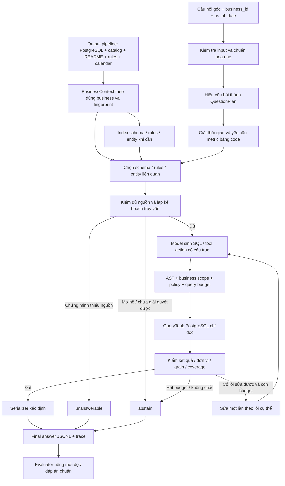

# Luồng agent và kế hoạch đánh giá từng công nghệ

Ngày lập: **06/11/2026, giờ Việt Nam**. Đây là thiết kế và kế hoạch thử nghiệm,
không phải báo cáo đã triển khai agent hay đã đạt điểm PA. Giữ nguyên split,
pipeline, model và evaluator hiện có trong bước lập kế hoạch này.

## 1. Hướng đi đề xuất

Xây **một agent có luồng điều phối rõ, dùng model local và gọi tool xác định**.
Trước tiên làm được vòng khép kín câu hỏi → truy vấn → đáp án → điểm. Sau đó
thêm từng công nghệ để biết nó có làm đúng hơn hoặc nhanh hơn không.

Không cần đưa rewriting, embedding, reranker, classifier và fine-tuning vào cùng
lúc. Chúng giải quyết những loại lỗi khác nhau, và có thể làm kết quả xấu đi.

| Thành phần hiện có | Trạng thái dùng làm nền |
|---|---|
| Qwen3-4B local + Transformers | Load/generate offline; có smoke sinh JSON/SQL |
| PostgreSQL + pipeline semantic | Train: 18 business, 80 bảng, 2.040.280 dòng nguồn |
| Semantic catalog/review | Có nghĩa cột, nguồn, kiểu, quality flags; metadata model vẫn là candidate |
| Evaluator local | Chấm final answers, chưa có điểm QA end-to-end |
| QueryTool cho SQL model | **Cần xây**; tool hiện tại chỉ list/describe/preview cố định |
| Time/metric resolver, serializer, agent runner | **Cần xây/nối thành contract hoàn chỉnh** |

Pipeline hiện có 21 trường hợp semantic chưa rõ, 22 xung đột và quality flags
quy đổi. Agent phải xem chúng khi dùng trường liên quan, không coi mọi role SLM
là sự thật. Các cột vẫn có trong nguồn; metadata chưa chắc chắn không tự đồng
nghĩa dữ liệu không tồn tại.

## 2. Hai luồng: chuẩn bị một lần và trả lời từng câu

Khi khởi động: kiểm manifests/config → nạp checkpoint local một lần → khởi tạo
tool registry và PostgreSQL connection pool → lấy/dựng BusinessContext theo từng
business. Các câu hỏi dùng chung model instance; không load weights lại mỗi câu.
Index/context có thể lazy-load và cache theo fingerprint để vừa RAM máy phát triển.



Nhánh index là **tùy chọn**. Baseline dùng toàn bộ schema compact của đúng business
nếu vừa context, chưa cần embedding/rerank. Chỉ index metadata và tên thực thể cần
lookup; phép SUM/COUNT/JOIN vẫn thực hiện trên toàn bộ bảng bằng PostgreSQL.

Không đọc Excel lại cho từng câu. Cũng không đưa toàn bộ transaction rows vào
vector database rồi dùng vài dòng gần nhất để tính doanh thu.

## 3. BusinessContext: agent nhận gì từ pipeline?

Đây là lớp nối cần làm đầu tiên, không để model tự tìm file tùy ý.

| Dữ liệu | Cách sử dụng |
|---|---|
| business_id, fingerprint, PostgreSQL schema | Giới hạn đúng doanh nghiệp/version |
| Compact schema | Tên bảng/cột thật, kiểu, tên gốc, mô tả, source refs |
| Grain/relationships | Phân biệt cấp đơn/dòng hàng/lô/snapshot; quan hệ chưa xác minh phải có flag |
| Semantic status | Tách mapping nguồn, mapping candidate, conflict và unresolved |
| README + rulebook | Căn cứ ý nghĩa, công thức, bộ lọc, đơn vị; có ID tham chiếu |
| Calendar + coverage | Giải ngày lễ, khoảng thời gian, kỳ ngoài dữ liệu |
| Quality summaries | Parse failures, NULL, quy đổi thiếu, quantity sai khác, orphan keys |
| Entity directory | Mã/tên sản phẩm, khách hàng, thuộc tính phân biệt và các khóa nối |

Không đổ nguyên catalog JSON hàng trăm KB vào prompt. Xây bản compact theo đúng
business, vẫn giữ đường lấy metadata đầy đủ qua tool. Không có answers/alias đáp
án trong context hoặc retrieval index. Alias thực thể từ source được phép, khác
với alias đáp án do evaluator quản lý.

Với trường đang unresolved/conflict: model có thể xem cột thật và README để lập
kế hoạch, nhưng phải nêu bằng chứng và qua kiểm tra liên quan. Không tự dùng
`semantic.proposed.role` thay role đã được chấp nhận. `safe_for_aggregation` chỉ
kiểm parse; không thay kiểm tra ngữ nghĩa, NULL, grain hoặc unit flags.

## 4. Từ câu hỏi đến kế hoạch: rewriting và classifier ở đâu?

### 4.1. Chuẩn hóa nhẹ — luôn có

Python chuẩn hóa Unicode NFC, khoảng trắng và kiểm ID/ngày hợp lệ. Giữ nguyên
`original_question`, mã hàng, số tiền, dấu âm, phủ định và đơn vị. Không bỏ dấu
tiếng Việt cho câu hỏi chính; có thể tạo thêm khóa lookup không dấu, vẫn giữ bản gốc.

### 4.2. Hiểu câu hỏi — thành phần bắt buộc

Một lần gọi Qwen hiện có tạo cấu trúc như:

```json
{
  "metric": "revenue",
  "entity_mentions": [],
  "time_expression": "tháng trước",
  "filters": [],
  "ranking": null,
  "answer_type_candidate": "number",
  "ambiguities": []
}
```

Đây là ví dụ format, không phải đáp án hay plan gắn với ID cuộc thi. Kế hoạch
phải giữ liên kết với câu chữ gốc, không tự thêm điều kiện không được hỏi.

Baseline đề xuất khoảng **hai lần gọi model/câu**: hiểu câu hỏi → code giải time
và chuẩn bị context → model sinh SQL. Chưa thêm một model classifier hay một call
rewrite riêng. Có thể thử baseline một call sau để so latency/chất lượng.

### 4.3. Query rewriting — thử sau baseline

Mục đích: hiểu viết tắt, lỗi gõ, tham chiếu và tạo cách diễn đạt hữu ích cho tìm
schema/entity. Ví dụ `sp nào bán chạy tháng rồi` có thể cần mở rộng viết tắt,
nhưng không tự đổi “bán chạy” thành doanh thu nếu rulebook không quy định như vậy.

Giữ song song câu gốc, câu rewrite và slots. Tìm context bằng cả câu gốc lẫn
rewrite khi cần; validator kiểm rewrite không đổi thực thể, số, ngày, phủ định,
đơn vị hoặc intent. Không dịch toàn bộ sang tiếng Anh làm baseline mặc định.

Lựa chọn: dictionary/regex có kiểm chứng; cùng Qwen3-4B; hoặc model đã SFT về
question understanding. Bắt đầu bằng cách gộp hiểu viết tắt vào call lập plan để
tránh tăng latency; call rewrite riêng chỉ giữ nếu đo được lợi ích.

### 4.4. Classifier — dùng để định tuyến, không tự tính đáp án

Nhãn hữu ích: sum/count/ranking/ratio, temporal complexity, cần lookup, cần join,
hoặc độ khó. Một câu có thể có nhiều nhãn, không ép thành một class duy nhất.

Ban đầu lấy các slots từ cùng planner. Nếu routing tốn nhiều call hoặc hay sai,
thử TF-IDF ký tự + Logistic Regression; sau đó embedding + linear head hoặc SLM
classifier. Nhãn phải do nhóm xác minh trên train. Không lấy expected answer type
từ answers làm input inference.

Classifier chỉ quyết định đi nhánh nào. Nó không được kết luận unanswerable chỉ
vì câu khó, hoặc bỏ tool kiểm chứng nguồn.

## 5. TimeResolver và MetricRegistry — nên dùng code

`TimeResolver(expression, as_of_date, rules, calendar)` trả khoảng ngày rõ ràng,
thường `[start, end)`, và bằng chứng. Tuần/tháng trước là kỳ lịch, không phải tự
trừ 7/30 ngày. Hỗ trợ ISO dates, kỳ so sánh, ngày lễ/âm lịch theo nguồn calendar;
không dùng ngày máy. Phrase chưa hỗ trợ được đánh dấu, không đoán.

`MetricRegistry` mô tả doanh thu, lãi gộp, lãi ròng, công nợ, tồn kho, tăng trưởng:
operands, grain, trạng thái mặc định, đơn vị, nguồn cần có và điều kiện coverage.
Không hard-code SQL/đáp án theo ID; đây là quy tắc nghiệp vụ tổng quát từ rulebook.
Câu hỏi có yêu cầu khác mặc định phải được xử lý đúng theo quy tắc ưu tiên nguồn.

Đây là nơi chặn SUM tiền cấp đơn sau join nhiều dòng hàng, cộng snapshots theo
thời gian, nhầm giá vốn hiện tại với giá vốn lúc bán hoặc lấy lợi nhuận từ doanh
thu khi thiếu chi phí. Không nhờ embedding/reranker giải những lỗi này.

Tech stack: Python `datetime`, `Decimal`, schema typed bằng dataclass/Pydantic,
test fixtures từ quy tắc. Các library parse ngày tự nhiên chỉ là ứng viên hỗ trợ;
kết quả phải qua quy tắc calendar/as_of_date của project.

## 6. Retrieval, embedding và reranker đặt ở đâu?

### 6.1. Ba kho tìm kiếm khác nhau

| Kho | Nội dung tìm | Kết quả cần trả |
|---|---|---|
| Schema | Bảng, cột, grain, unit, quan hệ, mô tả nguồn | Tên thật + evidence IDs + join paths |
| Rule/README | Đoạn quy tắc và cách hiểu dữ liệu | Đoạn nguồn nguyên văn + reference |
| Entity | Tên sản phẩm/khách + mã + thuộc tính phân biệt | Các ứng viên có ID và điểm/margin |

Với entity, ưu tiên exact code/name, sau đó normalized lexical/fuzzy. Không gộp
hai sản phẩm chỉ vì gần vector: hàm lượng, size, quy cách và mã có thể khác nhau.
Khi chọn bảng, mở rộng qua quan hệ đã kiểm tra để giữ cả bảng nối trung gian.

### 6.2. Thứ tự công nghệ nên thử

1. **Full schema compact + exact lookup**: đối chứng cơ bản, không mất cột do top-k.
2. **Lexical**: token/character matching, BM25 cho đoạn text, RapidFuzz cho tên;
   `pg_trgm` là lựa chọn fuzzy ngay trong PostgreSQL.
3. **Dense embedding**: thử khi diễn đạt khác từ ngữ khiến lexical bỏ sót.
   Ứng viên local: Qwen3-Embedding-0.6B; dùng đúng instruction, pooling,
   normalization và dimension của model card, không dùng trung bình hidden states tùy ý.
4. **Hybrid**: hợp ứng viên lexical + dense, có thể gộp thứ hạng bằng RRF để tránh
   cộng trực tiếp hai loại điểm không cùng thang đo.
5. **Reranker**: sau candidate retrieval, chấm lại từng cặp câu hỏi–context.
   Ứng viên: Qwen3-Reranker-0.6B. Nó không thể cứu một cột chưa vào candidate set.

Ví dụ budget thử nghiệm, không phải cấu hình đã chứng minh tốt: retrieve 20 mục
→ rerank → giữ 8 mục → mở rộng join paths. Giới hạn cuối theo token budget thay
vì chỉ số mục. Có fallback mở rộng context khi verifier thấy thiếu dependency.

Index theo business và source fingerprint. Cache vector theo model revision,
instruction, dimension, code và nguồn. Không trộn entity các doanh nghiệp.

Lưu vector nhỏ: NumPy cosine là đủ để thử. Khi cần nhiều index/query hơn có thể
chọn FAISS, pgvector hoặc Qdrant; chỉ thêm database/service nếu nhu cầu thực tế
đáng chi phí đóng gói offline. pg_trgm/pgvector phải có binary extension sẵn trong
image, không giả định installer PostgreSQL hiện tại đã đóng gói chúng.

## 7. Model gọi tool ở đâu và được gọi gì?

Các hàm dùng tool schema chặt, mọi lời gọi đi qua Python orchestrator. Không cấp
shell, đọc file tùy ý hoặc arbitrary Python execution cho model.

| Tool dự kiến | Thời điểm gọi | Contract chính |
|---|---|---|
| list_tables / describe_table | Khám phá context | Bảng/cột thuộc đúng business |
| lookup_entity | Trước sinh SQL | Mention → ứng viên ID/tên, không tự chọn nếu mơ hồ |
| resolve_period | Sau hiểu câu hỏi | Expression + as_of_date → time bounds xác minh |
| get_metric_requirements | Trước answerability/SQL | Metric → operands, grain, rules, coverage checks |
| inspect_quality | Khi plan dùng cột/quan hệ có flag | Counts/errors/units/source evidence |
| execute_readonly_sql | Sau kiểm tra SQL | Typed rows, row_count, truncated, warnings, provenance, timing |

Các tool ngoài list/describe/preview hiện có là **đề xuất cần triển khai**.

SQL guard bắt buộc: SQLGlot dialect PostgreSQL, một statement SELECT/CTE hợp lệ,
bảng/cột/function allowlist, chỉ schema business được cấp; chặn write, external
access, unsafe functions và host-date functions. AST check không phải sandbox.

PostgreSQL runtime dùng role riêng chỉ SELECT trên views/bảng được phép, không
owner/superuser. Có readonly transaction, statement/lock timeout, search_path cố
định, giới hạn kết quả và rollback. Cần kiểm thêm OS/container isolation cho runner.
Không dùng owner DSN ingestion hiện tại cho SQL do model sinh.

Không LIMIT input trước SUM/COUNT. Nếu kết quả tool bị truncate, không đưa sample
thành final list/table; phân trang hoặc xử lý bằng SQL theo contract. Tổng hợp trả
một dòng có thể đọc toàn bộ nguồn mà không gửi toàn bộ rows vào prompt.

## 8. Agent loop, verifier và quyết định cuối

Baseline không sửa lại SQL. Thử tiếp nhánh tối đa một lần sửa: tool báo lỗi cụ thể
hoặc verifier phát hiện sai date/join/unit → model sửa → kiểm tra và chạy lại.
Budget khởi đầu để benchmark: 2 model calls cơ bản, thêm tối đa 1 repair call,
không quá 2 SQL executions, timeout SQL ban đầu 5 giây/call và budget token rõ.
Các số này cần đo trên workload; chưa cam kết là tối ưu.

Verifier ưu tiên code: time bounds, operand availability, đơn vị, NULL, coverage,
duplicate/join fanout, query scope, expected result shape. Metamorphic checks có
điều kiện: hai khoảng rời nhau cộng thành tổng nếu metric có tính cộng; thứ tự
rows không đổi kết quả aggregate; không áp phép kiểm đó cho stock snapshots.

Chỉ thử verifier LLM thứ hai hoặc nhiều SQL candidates khi code không bắt được
lỗi quan trọng. Dùng cùng checkpoint cũng có thể lặp lại cùng sai lầm; đồng thuận
không phải bằng chứng đúng. Chạy nhiều candidate đúng và chọn bằng gold là oracle
phân tích, không phải score triển khai.

| Quyết định | Khi nào |
|---|---|
| answer | Có kết quả đã thực thi, đúng contract và đủ căn cứ |
| unanswerable | Chứng minh nguồn/operand/coverage cần thiết thật sự không có |
| abstain | Mơ hồ, metadata chưa đủ xác minh, tool/SQL lỗi hết budget, hoặc thuật toán chưa giải được |

Dữ liệu có mà tool chưa hỗ trợ phải abstain, không giả là unanswerable. Kết quả
rỗng/0 không tự chứng minh thiếu dữ liệu hoặc không có phát sinh; phải kiểm coverage.
Threshold abstention chọn trên calibration. Không dùng confidence model tự khai
hoặc cosine/reranker score như xác suất đáp án đúng.

## 9. Serializer và trace

Serializer bằng code chuyển typed result thành number/percent/string/date/boolean/
list/table. Quyết định thứ tự, ties, rounding, phần trăm theo rulebook. Giữ Decimal
đến bước xuất; kiểm giá trị JSON number không âm thầm mất độ chính xác. Lỗi format
không được “sửa” bằng việc nhìn đáp án chuẩn.

Ghi final answer sau từng câu để không mất cả run khi bị ngắt. Log riêng gồm:
câu gốc/rewrite/slots, context IDs, time bounds, rules, SQL và parameters, kết quả
tool/warnings, checks, model/revision/prompt, token counts, timings từng bước,
load/indexing dùng chung, final decision và lý do abstain/unanswerable. Không bịa
reasoning nếu model non-thinking không sinh reasoning.

Giữ evaluator ở process/lớp riêng mới được đọc answers. Prediction phải được
đóng băng trước khi chấm; diagnostics chứa gold không được đưa vào prompt/index.

## 10. Lựa chọn stack: nên dùng trước và lựa chọn để tìm hiểu

| Chỗ dùng | Khởi đầu đề xuất | Lựa chọn tiếp theo / lý do |
|---|---|---|
| Điều phối | Python state machine + typed contracts | LangGraph khi cần checkpoint/resume/nhánh phức tạp; không tự tăng accuracy |
| LLM | Qwen3-4B + Transformers, non-thinking | So 8B quantized nếu lỗi năng lực còn nhiều và VRAM/budget cho phép |
| JSON contract | Strict parser + Pydantic/dataclass | LM Format Enforcer/XGrammar; ép format không bảo đảm semantic đúng |
| SQL | PostgreSQL + psycopg + SQLGlot | SQL templates/AST compiler cho metric chuẩn, model lập plan thay vì viết mọi SQL |
| Lookup | Exact + Unicode keys + RapidFuzz | pg_trgm cho fuzzy search có index |
| Retrieval | Full compact schema/BM25 | Qwen embedding, hybrid/RRF, rồi reranker nếu cần |
| Vector index | NumPy cho index nhỏ | FAISS/pgvector/Qdrant khi đo thấy cần |
| Classifier | Dùng slots cùng planner | TF-IDF char + Logistic Regression, embedding + linear head, SLM classifier |
| Verification | Rules, constraints, execution/metamorphic checks | LLM critic / multiple candidates có budget |
| Few-shot | Ví dụ đã xác minh từ train | Retrieval ví dụ train; không index dev/cal/holdout answers |
| Inference speed | Transformers đã chạy ổn | vLLM batching/prefix cache sau khi khóa behavior; benchmark cold/warm |
| Training | Chưa train trước khi có error analysis | PEFT LoRA/QLoRA + TRL SFTTrainer; DPO/RL là nhánh muộn |
| Experiment log | JSONL + manifest + local report | MLflow local/OpenTelemetry nếu cần; không bắt buộc cloud |

Cache cũng là một lựa chọn tối ưu: metadata/index theo source fingerprint;
query results theo SQL đã xác minh + parameters + nguồn/rules/time bounds; model
plans theo model/prompt/config và input đầy đủ. Không cache đáp án chỉ theo câu
text hoặc business_id vì as_of_date/nguồn có thể khác. Prefix cache theo business
chỉ thử sau khi khóa behavior và đo riêng cold/warm.

Chưa cài các lựa chọn mới trong bước lập kế hoạch. Tài liệu web hiện tại có thể
thuộc version mới hơn stack 4.51.3/2.7.1 đang dùng: mỗi nhánh phải pin version và
kiểm compatibility trong env riêng trước khi đổi baseline.

## 11. Fine-tune khi nào, train cái gì, làm thế nào?

Chỉ mở khi baseline chạy/chấm được, tools/rules ổn và lỗi model lặp lại còn chiếm
phần đáng kể: viết tắt, chọn schema, sai tool contract, SQL patterns hoặc quyết định
answerability. Không train để chữa parser, thiếu nguồn hoặc công thức code sai.

**Dataset supervision:** chỉ từ 1.583 câu thuộc train và synthetic hợp lệ. Final
answers không tự tạo ground-truth SQL. Tạo QuestionPlan/SQL/trajectory candidates,
thực thi và review để xác minh grain/filter/time/unit; trùng final answer trên một
database chưa đủ chứng minh SQL đúng. Thêm schema/date perturbations khi hợp lệ,
counterexamples và negative cases không trả lời được. Có thể dùng cùng model
local tạo candidate, nhưng không nhận chúng làm nhãn nếu chưa xác minh.

Tách theo business/template trước augmentation. Bản viết lại của cùng câu không
lọt sang validation. Dùng grouped folds bên trong train để kiểm/checkpoint; 708
câu development dùng chọn hệ thống cuối. Không lấy reference SQL/trajectory từ
dev/cal/holdout để train hoặc làm few-shot.

Bắt đầu pilot 200–500 mẫu **đã kiểm chứng**, không hứa có sẵn đủ mẫu. Train SFT
plan/tool/SQL và các decision cases; loss masking phần assistant, không bắt model
học lại prompt/source text. Có thể dùng schema aliases/SQL tương đương thay vì ép
đúng một chuỗi SQL duy nhất. Dùng curriculum đơn giản → joins/ratio/temporal.

Ứng viên cho GPU 16 GB: QLoRA 4-bit NF4 + PEFT/TRL, batch nhỏ, gradient accumulation,
gradient checkpointing và thử sequence 2K rồi 4K. Pilot rank 8/16, learning rate
5e-5/1e-4, 1–2 epochs là phạm vi thử, **chưa phải cấu hình bảo đảm vừa VRAM hay
tốt hơn**. Đo OOM/throughput trên 10–20 samples trước. Giữ env train riêng.

So base và tuned trên cùng input/context/tools/decoding; checkpoint chọn bằng
grouped validation/dev. Sau đó chạy lại pipeline semantic regression nếu checkpoint
được dùng cho cả ingestion. Nếu giữ base model cho ingestion và tuned model cho
QA, phải tính cả hai checkpoint trong tổng model inference và thời gian cold start.
Không đồng thời đổi checkpoint QA và schema-prep mà quy mọi gain cho fine-tuning.

DPO chỉ cân nhắc khi có preference pairs đúng–sai đã kiểm chứng, cùng prompt và
bằng chứng thực thi; RL execution reward dễ thưởng SQL may mắn đúng, chi phí lớn.
Không ưu tiên hai nhánh này trước deadline.

## 12. Chia tập và chống rò rỉ khi thử từng stack

| Tập frozen | Business / câu | Dùng cho |
|---|---|---|
| Train | 18 / 1.583 | Debug, tạo nhãn công cụ/retrieval, few-shot, supervision, grouped CV |
| Development | 6 / 708 | So các cấu hình, error analysis, chọn stack/checkpoint |
| Calibration | 3 / 355 | Sau khi chốt model/retrieval/tools, chọn ngưỡng abstention |
| Holdout | 3 / 354 | Đánh giá cuối sau khi freeze; không tune sau khi xem |

Pipeline hiện chỉ chuẩn bị train. Cần chuẩn bị development bằng cùng code/model
policy, không đọc labels trong ingestion. Calibration/holdout chuẩn bị khi tới
đúng phase. Không thêm patch theo ID dựa trên đáp án của các tập này.

Holdout hiện chỉ coffee/restaurant, không có boolean/unanswerable labels. SQLite
thật ở calibration, mixed-source ở development; train không phủ hết định dạng.
Report theo format/industry/type và không coi holdout là đại diện đầy đủ. Dùng
synthetic format tests bổ sung, không lấy calibration labels làm dữ liệu train.

Public test chưa có labels: chỉ kiểm I/O, format, coverage lỗi và runtime; không
báo PA hay tạo gold bằng cách đoán. Giữ nguồn và split manifest bất biến.

## 13. Protocol thực nghiệm — cùng câu hỏi, đổi đúng thành phần

1. Freeze pipeline fingerprint, source, model revision, prompts, tool/serializer
   version, seed, decoding và budgets. Đặt experiment ID và parent baseline.
2. Bắt đầu smoke 20–30 câu train có chủ đích: scalar, ranking, join, thời gian,
   đơn vị, thiếu nguồn, list/table. Chỉ đánh giá score subset khi manifest xác định
   đúng IDs/mẫu số; evaluator hiện tại mặc định mẫu số toàn partition.
3. Chạy regression fixes và khoảng 100–200 câu train để kiểm độ ổn định/thời gian.
4. Chạy đủ 708 dev với mỗi ứng viên thực sự có triển vọng. Safety gates, time
   resolver và serializer giữ nguyên; không tắt guard để tạo đối chứng nguy hiểm.
5. Lưu predictions trước khi chấm, cùng per-question timings và trace. Mỗi biến
   thể chỉ đổi một thành phần. Nếu đổi nhiều thứ, gọi là joint experiment và chạy
   ablation bỏ từng thứ để tách hiệu quả.
   Không tái dùng final-answer cache của cấu hình khác để chấm biến thể mới;
   kết quả đó sẽ không đo được tác động của công nghệ vừa thêm.
6. Xem câu nào từ sai→đúng, đúng→sai, answer→abstain, abstain→answer. Lưu error
   taxonomy và nhóm có hồi quy; không chỉ xem một con số tổng.
7. Giữ candidate nếu PA/chi phí tốt hơn một cách thuyết phục và không phá safety.
   Gain nhỏ/noisy thì chưa kết luận; có thể ưu tiên phương án đơn giản, nhanh hơn.

Với dev chỉ 6 business, nên dùng paired resampling theo **business**, kết hợp
grouped CV train và per-business deltas; đừng coi 708 câu là 708 quan sát độc lập.
Thử quá nhiều cấu hình vẫn có thể overfit dev: giới hạn search budget, đăng ký
tiêu chí trước, log cả trial thất bại, chỉ dùng holdout sau khi freeze.

## 14. Ma trận thử nghiệm đề xuất

Các ID sau đều là **planned**, chưa có điểm. Chạy nhánh độc lập từ baseline đã
chốt để đo riêng, rồi mới kết hợp các nhánh thắng.

| ID | Đổi gì | Đối chứng / thứ giữ nguyên | Đo riêng | Quyết định |
|---|---|---|---|---|
| E0 | Baseline hai call, full compact schema, exact lookup, không repair | Nền tools/time/serializer cố định | PA, contract, SQL execution, latency | Có vòng khép kín, trace tái lập |
| E1 | Rewriting/slots cải tiến | E0, cùng context | Bảo toàn intent/entities/date/negation + PA | Không giữ nếu đổi nghĩa hoặc cost không bù gain |
| E2 | Lexical context/entity search | Full schema + exact | All-required-schema recall@k, entity recall, token savings, PA | Chấp nhận khi giảm cost mà không mất dependency quan trọng |
| E3 | Dense / hybrid | Lexical E2, cùng candidate/token budget | Recall@k, missing joins/rules, PA | Giữ nếu lexical thực sự bỏ sót và dense cứu được |
| E4 | Reranker | Cùng candidate pool E3, chỉ đổi thứ tự/chọn | MRR/nDCG, context recall, latency, PA | Không giữ chỉ vì ranking score tăng |
| E5 | Classifier routing | Cùng planner không classifier riêng | Macro-F1, route errors, calls saved, PA | Sai route không được tạo false unanswerable |
| E6 | Một lần SQL repair | Baseline thắng, repair=0 | Repair precision, wrong→correct/correct→wrong, p95 | Giữ nếu tăng PA trong budget |
| E7 | Grammar-constrained JSON | Cùng model/prompt/token cap | Valid contract, truncation, PA, tốc độ | Format tốt hơn nhưng không được đổi logic âm thầm |
| E8 | Retrieved few-shot train examples | Không few-shot, cùng context budget | Leakage checks, SQL semantics, PA | Dừng nếu chỉ thuộc template/answer |
| E9 | QLoRA/SFT | Base model, cùng tools/context | Dev PA theo business/type, regressions, VRAM | Giữ checkpoint tốt trên dữ liệu ngoài supervision |
| E10 | Transformers → vLLM / quantization | Cùng weights khi có thể | Answer agreement, PA, cold/warm speed, peak VRAM | Optimization phải qua semantic regression |
| E11 | Abstention policy | Cấu hình QA đã freeze | Calibration PA, coverage/risk curve | Chọn ngưỡng trên calibration, kiểm holdout một lần |

Ví dụ ablation kết hợp: E0; E0+rewrite; E0+hybrid; E0+rewrite+hybrid; cấu hình đó
có/không rerank. Không suy rằng các gain riêng sẽ tự cộng được với nhau.

## 15. Đo hiệu quả thế nào?

**Kết quả cuối:** PA = (correct − wrong) / N; wrong −1, correct +1, abstain 0.
Luôn report coverage, answered accuracy, missing/format errors, unanswerable
precision/recall, per-business/type/industry. Local evaluator là approximation,
chưa có executable scorer BTC để khẳng định hoàn toàn tương đương.

Trên 708 câu, một câu từ wrong→correct tăng 2/708 PA; wrong→abstain tăng 1/708;
correct→abstain giảm 1/708. Coverage thấp hơn không tự nghĩa tốt hơn. Nếu có xác
suất đúng đã hiệu chuẩn, expected gain của trả lời là 2p−1, nhưng không lấy p từ
confidence model tự khai. Threshold thực tế chọn bằng calibration và coverage/risk.

**Chẩn đoán từng tầng:**

| Tầng | Chỉ số cần có |
|---|---|
| Question understanding | Slot accuracy theo trường; bảo toàn entities/numbers/negation/time |
| Retrieval | Table/column/entity recall@k; có đủ **tất cả** operands + bridge tables/rules không |
| Rerank | MRR/nDCG khi có relevance labels, và recall sau token packing |
| SQL | Parse/execute success, đúng filter/time/join/grain/unit; không chỉ so chuỗi SQL |
| Tool/verifier | Cross-business leakage=0; writes=0; truncation detected; repair usefulness |
| Answerability | Unanswerable precision/recall; false unanswerable; false confident answers |
| Serializer | Type/shape/date/percent/rounding/list/table contracts |
| Runtime | Load/prep/index time, calls/tokens, p50/p95/max latency, peak RAM/VRAM |

Nhãn retrieval/SQL không có sẵn từ answers: nhóm cần annotate một diagnostic set
train, rồi một dev diagnostic set được cách ly khỏi train/few-shot. Mỗi câu có thể
có nhiều SQL/column sets hợp lệ. Diagnostic annotations không vào model context;
vẫn phải chấm đủ dev bằng final answers để tránh chỉ tối ưu subset dễ.

Error taxonomy tối thiểu: question, time, schema, entity, missing context, rule,
join/fanout, unit, source quality, SQL syntax/tool, answerability, serialization,
timeout. Cho phép nhiều nguyên nhân; có nhãn nguyên nhân chính để ưu tiên sửa.

**Oracle analysis để tìm bottleneck:** thay riêng time bounds hoặc context bằng
bản người đã xác minh rồi chạy phần còn lại trên diagnostic set. Score này chỉ là
ước lượng tiềm năng của tầng đó, không gọi là điểm agent và không dùng trong submission.

## 16. Tổ chức code và artifacts dự kiến

```text
src/datamate_agent/       # B: state, planner, retrieval policy, bounded loop
src/datamate_tools/       # interface A/B: time/metric/entity/SQL/quality tools
src/datamate_training/    # chỉ tạo khi mở nhánh training
configs/agent/            # baseline + feature flags + budgets
scripts/run_agent.py     # runner inference, không quyền đọc answers
scripts/compare_runs.py   # paired deltas và error transition reports
tests/                   # tool safety, time/grain/unit/serializer, regression
outputs/agent/<run_id>/
  manifest.json
  submission.jsonl
  timings.jsonl
  traces/*.json
  evaluation/report.json
  evaluation/per_question.jsonl
  comparison.json
```

Đây là đường dẫn **dự kiến, chưa tạo các module/CLI này**. Giữ API model B1,
BusinessContext pipeline và evaluator tương thích; thống nhất interface với A/C
trước khi nối, không ghi đè code của họ. Không xóa output pipeline đã chốt.

Manifest cần có parent run, feature flags, source/split/pipeline hashes, model and
index revisions, prompt/tool versions, actual parameter counts, seed, hardware,
budgets và cold/warm/replay status. Các report evaluator không đặt trong input
directory mà agent được phép đọc.

Lệnh chấm đã có, chỉ dùng sau khi runner tạo final answers thật:

```bash
python3 scripts/evaluate.py \
  --partition development \
  --predictions outputs/agent/<run_id>/submission.jsonl \
  --timings outputs/agent/<run_id>/timings.jsonl \
  --output-dir outputs/agent/<run_id>/evaluation
```

Không chạy lệnh với placeholder. Không đưa B1 plans.jsonl vào scorer như final
answers. Subset evaluator/comparison runner là hạng mục cần thêm trước pilot scores.

## 17. Thứ tự triển khai thực tế

1. **Tool layer + BusinessContext + serializer:** kiểm tay các truy vấn tổng,
   ranking, join, ngày và thiếu nguồn; thêm bộ synthetic safety/format tests.
2. **E0 trên 20–30 train:** load model một lần, tạo final JSONL và score subset
   đúng mẫu số. Sửa lỗi nền tảng, không tune theo ID/đáp án.
3. **E0 đầy đủ development:** chuẩn bị 6 business dev, đo điểm và phân loại lỗi.
4. **Chọn nhánh theo lỗi:** rewrite nếu sai hiểu; entity/lexical nếu nhầm tên;
   embedding nếu thiếu context; rerank nếu ứng viên có nhưng chọn sai; repair/
   constrained decoding nếu contract/SQL hay lỗi. Chạy từng experiment và ablation.
5. **SFT có điều kiện:** chỉ nếu lỗi hành vi còn lặp và có đủ supervision đã kiểm.
6. **Freeze QA → calibration → holdout:** chọn abstention thresholds, chấm cuối;
   nếu còn tiếp tục tune sau holdout thì không được gọi nó là đánh giá độc lập nữa.
7. **Cold-start offline Docker:** toàn bộ data prep/index/model loading/inference/
   logs trong budget. Kiểm shutdown/resume và ghi đáp án theo từng câu.

Nếu còn giữ mốc nộp 16/11 trong brief: đề xuất ưu tiên baseline trong 1–2 ngày,
chọn 1–2 nhánh có bằng chứng thay vì làm đủ mọi stack, giữ khoảng 48 giờ cuối cho
đóng gói/regression. Đây là lịch đề xuất phụ thuộc kết quả, không phải cam kết
ngày hoàn thành hay xác nhận lại lịch BTC ngoài tài liệu đã có.

## 18. Ràng buộc và chọn công nghệ trong giới hạn thật

Nguồn chính thức trong workspace: PDF Description/Rules/Evaluation trang 2 và
Docker guideline trang 2, 6, 9: tổng mọi inference models ≤15B tham số, tính cả
embedding/reranker/classifier, dù load lần lượt; weights gốc trước 26/10/2026,
license phù hợp; offline; private run ≤6 giờ gồm load. Máy tham chiếu 2 RTX 5090
32 GB mỗi GPU, RAM 512 GB, CUDA ≥12.8; không tự coi VRAM hai GPU thành một vùng.

Máy phát triển hiện tại 4080 SUPER 16 GB, RAM WSL khoảng 9,7 GiB. Khởi đầu 4B đã
đo thực tế; không mặc định full fine-tune hoặc load 8B bfloat16 cùng các model phụ.
Qwen3-4B có **4.022.468.096** tham số theo wrapper hiện có. Model phụ mới phải tải
revision cố định, kiểm license/release và đếm tham số thực tế trước khi đưa vào
solution; không cộng các nhãn làm tròn 4B/0.6B để kết luận hợp lệ.

Nếu thêm tuned checkpoint, SLM pipeline, verifier hoặc classifiers riêng, lập
danh sách **mọi checkpoint thực sự dùng ở cold run**; LoRA/quantization không cho
phép bỏ qua base weights khi khai báo. Nếu chưa rõ quy tắc đếm model dùng chung,
không dựa vào giả định có lợi để vượt trần. Đo peak VRAM riêng với batch/context.

Runtime budget cần đo cả cold start: model load + source preparation + indexing +
tổng câu hỏi + logging. Không chỉ lấy tốc độ decode; không dùng cache train đã
có để giả lập private source mới. So cold/warm và dự phóng có dư địa theo số câu
trong guide; benchmark trên GPU chấm trước khi khẳng định đạt 6 giờ.

## 19. Nguồn kỹ thuật để tìm hiểu

Các liên kết được kiểm tra ngày 06/11/2026; version runtime vẫn phải pin và thử
trong env riêng. Chúng chứng minh khả năng của công cụ, **không chứng minh tăng
điểm trên DataMate**.

- [Qwen3-Embedding-0.6B, model card chính thức](https://huggingface.co/Qwen/Qwen3-Embedding-0.6B): instruction/pooling/dimension cho embedding.
- [Qwen3-Reranker-0.6B, model card chính thức](https://huggingface.co/Qwen/Qwen3-Reranker-0.6B): cách chấm query–document theo model.
- [PostgreSQL pg_trgm](https://www.postgresql.org/docs/current/pgtrgm.html): similarity và index cho tìm text gần giống.
- [RapidFuzz](https://github.com/rapidfuzz/RapidFuzz): lựa chọn fuzzy matching tên bằng Python.
- [scikit-learn Logistic Regression](https://scikit-learn.org/stable/modules/linear_model.html#logistic-regression): classifier tuyến tính để thử routing.
- [PEFT quantization/QLoRA](https://huggingface.co/docs/peft/developer_guides/quantization): bitsandbytes/NF4 và adapter training.
- [TRL SFTTrainer](https://huggingface.co/docs/trl/sft_trainer): supervised fine-tuning và dữ liệu hội thoại.
- [LM Format Enforcer](https://github.com/noamgat/lm-format-enforcer): ràng buộc format bằng token filtering; thử compatibility với Transformers đã pin.
- [XGrammar](https://github.com/mlc-ai/xgrammar): lựa chọn grammar-constrained generation, cần thử integration/version cụ thể.
- [vLLM structured outputs](https://docs.vllm.ai/en/stable/features/structured_outputs/): structured decoding trong nhánh inference engine sau.
- [LangGraph overview](https://docs.langchain.com/oss/python/langgraph/overview): orchestration có state/checkpoint nếu vòng lặp thật sự cần.

Tài liệu nội bộ liên quan: [brief](DATAMATE_PROJECT_BRIEF.md),
[pipeline hiện tại](DATA_PIPELINE.md), [split](DATA_SPLIT_V1.md),
[evaluator](EVALUATOR.md), [báo cáo pipeline](DATA_PIPELINE_VALIDATION.json).
