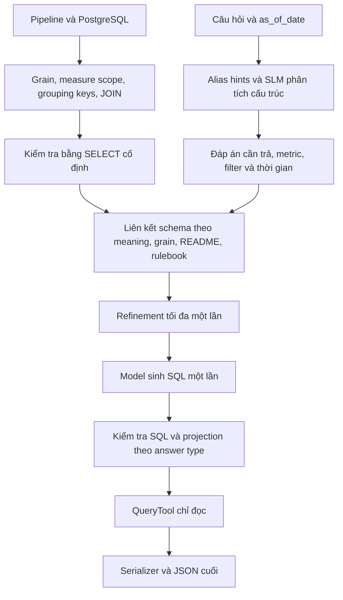

# Baseline v2: hiểu câu hỏi và chọn dữ liệu theo grain

Baseline hiện tại bổ sung metadata nghiệp vụ và hai lượt model trước sinh SQL. Không fine-tune, embedding, alias learning từ development/test hoặc SQL repair. Output local đã được dọn để giữ train, development cho v2, metadata v2 và run v2. Các module B1 vẫn cần cho model wrapper và contract.

## Luồng



“Danh sách khách hàng” định hướng cột khách hàng cần trả; “mua nhiều đơn nhất” quyết định đếm đơn phân biệt theo khách. “Doanh thu” là metric có phép tính và điều kiện theo rulebook, không tự đồng nhất với một cột money. Alias chỉ gợi ý. Semantic role khác cách viết vẫn được SLM so sánh theo ý nghĩa, đối tượng, kiểu và scope.

Mỗi câu có hai lượt analysis/linking, tối đa một refinement dùng chung cho hai bước và một lượt SQL: tối đa 4 attempts. Không grounded thì không gọi SQL. Không sửa SQL sau lỗi. Model load một lần mỗi batch, messages mới cho từng câu.

## Metadata nghiệp vụ

`src/datamate_data/business_metadata.py` tạo sidecar, không sửa dữ liệu hoặc canonical/semantic role đã chốt. SLM đọc schema toàn biz, README, rulebook và đề xuất cho từng bảng đích. Nhãn cũ như sale_lines là heuristic, có thể sai với bảng giao hàng, không được coi là grain đã xác minh.

- `grain`: kind, mô tả, evidence và trạng thái candidate.
- `group_keys`: cột nhóm, mục đích, kiểm tra NULL và số nhóm khác nhau. Khóa nhóm có thể lặp; không nhầm với khóa duy nhất của dòng.
- `measures`: native scope, aggregation, unit và kiểm tra biến thiên trong nhóm. Một đề xuất mỗi cột; không coi giá trị giống nhau trong nhóm là proof SUM được.
- `joins`: cột nối, evidence, kiểm tra kiểu, cardinality, orphan rows và fanout risk. Structural checks không chứng minh ý nghĩa JOIN đúng.

Định danh phải tồn tại. Lỗi contract được thử lại tối đa một lần/bảng; vẫn lỗi giữ unknown. Evidence chỉ được đánh dấu quote verified nếu là đoạn nguyên văn README; còn lại là unverified proposal. Không tự nhận khóa duy nhất vì role có chữ ID. Data checks chỉ chạy SELECT cố định với identifiers được quote, không chạy SQL do SLM tạo.

Sidecar gắn hash với catalog, README và rulebook. Runner từ chối metadata của source/catalog khác:

```text
outputs/business_metadata/development_v2/<biz>/
  metadata.json       # Metadata và data checks
  review.md           # Mở bằng VS Code Markdown preview
  model_calls.jsonl   # Prompt/raw output/timing/token/error từng attempt
```

Ingest mới: thêm `--business-metadata` vào `scripts/prepare_pipeline.py` khi dùng local semantic và PostgreSQL. Metadata nằm trong `<prepared biz>/business_metadata/`. Với dữ liệu hiện có, enrich riêng để tránh ingest và map cột lại.

Xem metadata đã tạo, không cần model hoặc database:

```bash
.venv-b1-gpu/bin/python scripts/inspect_pipeline.py \
  --prepared-dir outputs/data_pipeline/development_v1/biz_118 \
  --business-metadata --metadata-root outputs/business_metadata/development_v2 \
  | python3 -m json.tool --no-ensure-ascii
```

## Chạy

Tại root repository, dùng venv/model hiện có. Chỉ một process inference GPU tại một thời điểm.

```bash
python3 scripts/local_postgres.py start
export DATAMATE_PG_DSN="$(python3 scripts/local_postgres.py dsn)"
export DATAMATE_BASELINE_PG_DSN="$(.venv-b1-gpu/bin/python scripts/setup_baseline_readonly.py \
  --prepared-root outputs/data_pipeline/development_v1 --print-dsn)"
```

Metadata `outputs/business_metadata/development_v2` đã có sẵn trên máy hiện tại; không cần chạy enrich lại. Chỉ dùng lệnh sau khi chuẩn bị dữ liệu trên máy mới (output root phải mới):

```bash
.venv-b1-gpu/bin/python -u scripts/prepare_business_metadata.py \
  --prepared-root outputs/data_pipeline/development_v1 \
  --output-root outputs/business_metadata/development_v2
```

Chạy cùng 50 ID đã chốt trong `artifacts/baseline_grounded_v2/question_ids.json` (giữ nguyên danh sách sau khi xóa run nguồn cũ):

```bash
.venv-b1-gpu/bin/python -u scripts/run_baseline.py \
  --config configs/baseline_grounded_model.json \
  --prepared-root outputs/data_pipeline/development_v1 \
  --metadata-root outputs/business_metadata/development_v2 \
  --questions-file artifacts/data_split_v1/inputs/development/questions.jsonl \
  --question-ids artifacts/baseline_grounded_v2/question_ids.json \
  --output-dir outputs/baseline/development50_v2_next
```

Metadata inline: bỏ `--metadata-root`. Output directory phải mới. Model giữ Qwen3-4B pinned revision, BF16, non-thinking, context 24.576 và output 1.024 token/lượt baseline; metadata prep dùng context 16.384/output 2.048. Context baseline tăng vì linking toàn biz_124 đã khoảng 17.000 token trước khi thêm câu hỏi; không cắt schema/rule để vừa 16K. Không API AI bên ngoài.

Sau inference mới chấm và tạo HTML:

```bash
.venv-b1-gpu/bin/python scripts/evaluate_baseline_run.py \
  --run-dir outputs/baseline/development50_v2_next --partition development --subset
.venv-b1-gpu/bin/python scripts/summarize_baseline.py \
  --run-dir outputs/baseline/development50_v2_next
```

## Context và quyết định

Question analysis lưu metric/meaning, entity, operation, filters, khoảng thời gian ISO và `answer={type,target,granularity}`. Rule candidates và schema linking lưu riêng để biết chọn cột nào và vì sao.

Linking nhận toàn schema và metadata summaries của biz, README/rulebook đầy đủ. Column arrays có legend columns_format để tránh lặp tên trường, vẫn giữ canonical/semantic role tách biệt. SQL stage nhận toàn schema, source docs và metadata chi tiết của các bảng liên kết. metadata_selection ghi rõ bảng nào được chọn. Vượt token budget thì abstain, không cắt prompt âm thầm.

Metadata summaries giữ grain, keys, scope/aggregation/unit, data checks và evidence status; bỏ prose lặp và quote đã có trong README. Full evidence/diagnostics ở sidecar review. Đây vẫn là candidates, không phải rulebook mới.

Không khớp tên không đồng nghĩa dữ liệu thiếu. missing_data cần README quote có dấu hiệu nêu thiếu thông tin; đây là kiểm tra contract cần thiết, không phải proof ngữ nghĩa. Ambiguity/lỗi kỹ thuật → abstain. SQL stage không tự đổi grounded thành unanswerable thiếu bằng chứng. Chưa có calendar lookup.

Projection được kiểm tra trước query: scalar/list một cột, answer_type khớp structured answer; không tự lấy cột đầu hoặc đổi type. Serializer vẫn kiểm tra số dòng/NULL/giá trị. answer_contract là nhóm lỗi mới, phải cộng vào tổng lỗi khi so v1/v2, không chỉ nhìn serialization giảm.

## Xem trace và đánh giá

Các trường mới trong traces.jsonl và report.html:

- question_analysis, gồm đáp án mong muốn.
- rule_binding_candidates: ứng viên rule-based, chưa là binding cuối.
- schema_linking: output/required columns, group_by, JOIN và lý do.
- understanding_calls: prompt/raw/error/token/timing từng lượt; refinement_used.
- messages: prompt SQL cuối cùng, gồm lựa chọn metadata.

Predictions giữ contract cũ. Labels chỉ do evaluator đọc sau inference, không vào analysis/linking/SQL prompt.

Run được giữ tại `outputs/baseline/development50_v2/` bị ngắt sau 34/50 câu. Nó không phải một run hoàn tất 50 câu. Không có resume tự động; lệnh trên chạy lại 50 câu vào thư mục mới. Có thể thêm `--limit 5` và đổi output directory để thử nhỏ trước.

Kết quả mới nằm trong `outputs/baseline/development50_v2_next/`: `predictions.jsonl`, `traces.jsonl`, `timings.jsonl`, `run.json`; sau khi chấm/tạo báo cáo có thêm `evaluation/`, `summary.md`, `report.html`. So sánh cùng tập ID và đọc cả lỗi lẫn đáp án sai; giảm lỗi format không tự chứng minh metric đúng. Development đã được inspect nên không phải phép đánh giá generalization độc lập; calibration/holdout chưa dùng để tối ưu.

## Trạng thái sau khi dọn workspace

- Data pipeline: `postgres-pipeline-v4-semantic`, canonical-first và bounded refinement; train 18 biz/80 bảng, development 6 biz/29 bảng.
- Metadata development: `outputs/business_metadata/development_v2` khớp catalog `outputs/data_pipeline/development_v1`.
- Config model: `configs/baseline_grounded_model.json`; Qwen3-4B local, pinned revision, BF16, non-thinking.
- Code baseline khớp SHA-256 của 13 file trong manifest v2; không còn module A–B–C v3 hoặc backup rollback.
- Kiểm thử sau rollback: 140 tests đạt, 7 PostgreSQL integration tests skip vì chưa đặt DSN kiểm thử. Chưa chạy model lại sau rollback/dọn output.
- Weights, virtualenv, PostgreSQL và các output lớn được giữ local và Git ignore. Git lưu code, tài liệu, frozen split manifests và artifacts schema/review train nhỏ.
