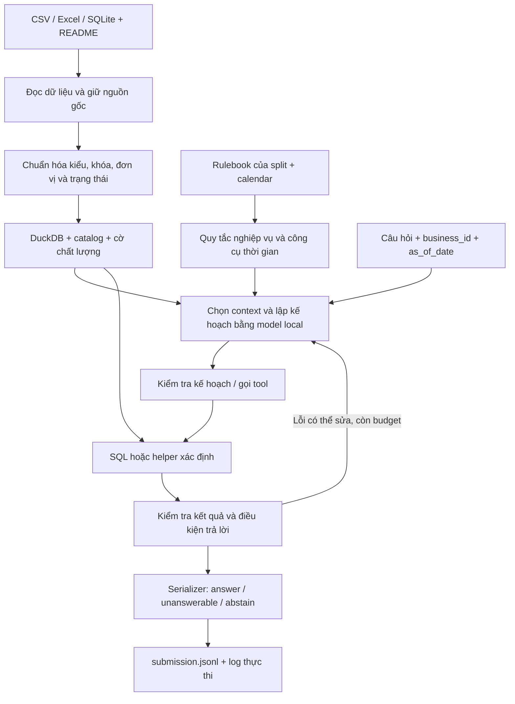

# Kế hoạch hoàn thành DataMate — dựa trên dữ liệu đã có

Ngày khảo sát: **05/11/2026, giờ Việt Nam**. Đây là kế hoạch triển khai, chưa phải
báo cáo rằng pipeline/train/Docker đã hoàn thành. Brief và PDF gốc được giữ nguyên.
Các tên script/module chưa tồn tại dưới đây là **đầu ra dự kiến cần xây dựng**.

**Hướng đi đề xuất:** làm cho máy đọc đúng dữ liệu, áp dụng đúng luật và tính đúng
trước; sau đó mới đánh giá model, bổ sung tìm kiếm hoặc fine-tuning theo lỗi đo được.
Model phụ trách hiểu câu hỏi và lập kế hoạch; SQL/hàm Python phụ trách tính toán.

## 1. Hiện tại đã có gì?

Khảo sát trực tiếp thư mục đã giải nén, không tính bản ZIP và `:Zone.Identifier`
là dữ liệu kinh doanh. Chi tiết quan sát ở `DATAMATE_DATA_AUDIT.json`.

| Nội dung | Train | Public test |
|---|---:|---:|
| Doanh nghiệp | 30 | 14 |
| Câu hỏi | 3.000 | 1.000 |
| Đáp án được cung cấp | 3.000 | Không thấy file đáp án |
| File XLSX | 107 | 69 |
| File CSV kinh doanh | 20 | 10 |
| File SQLite | 1 | 1 |
| README doanh nghiệp | 30 | 14 |
| Calendar | 1.461 ngày, 2024–2027 | 1.461 ngày, 2024–2027 |

Train có 1.884 number, 578 percent, 193 list, 145 date, 88 string,
70 unanswerable, 23 boolean và 19 table. ID câu hỏi khớp ID đáp án; đáp án không
có ID trùng. Mỗi đáp án có `alias` dạng list. Không coi dữ liệu train đã có SQL
chuẩn: file đáp án hiện cung cấp **giá trị cuối**, không cung cấp sẵn query/trajectory.

Một số quan sát ảnh hưởng trực tiếp đến thiết kế:

- `biz_102`: một workbook chia nhiều sheet tháng, không có mã sản phẩm, nối bằng tên.
- `biz_106`: bảng hóa đơn và chi tiết tách file, có dòng tiêu đề trước header;
  bảng chi tiết còn tách `_1`, `_2`.
- `biz_117`: header nhiều dòng, ngày thiếu năm, số tiền như `1tr440`, số lượng có đơn vị.
  README cho biết dòng âm cùng mã đơn biểu thị trả hàng.
- `biz_119`: quan hệ hóa đơn → dòng hàng → nhiều lô; tồn kho là snapshot cuối dữ liệu.
- `biz_123`: SQLite có 17 bảng, các ngày giờ dạng text; nhiều bảng mang `IDCuaHang`,
  vì vậy phải kiểm tra khóa ghép thay vì chỉ nối theo mã hóa đơn/mã hàng.
- `biz_124`: trộn Excel phần mềm, sổ tay và CSV; có bảng nối bằng mã, có bảng nối tên.
- Có `.Rhistory` và các file `:Zone.Identifier`: ghi nhận là file phụ, không thực thi
  hay nạp vào query store. Bản audit mới chỉ xem layout Excel đại diện, chưa kiểm tra
  chất lượng mọi ô hoặc mọi sheet.

B1 đã có local model wrapper, download manifest, CLI, parser và logs. RTX 4080 SUPER
16 GiB đã chạy Qwen3-4B BF16; 13 tests pass. Smoke cuối có 3 JSON hợp lệ nhưng chỉ
2 output qua contract, câu tuần trước vẫn sai. Đây là nền tảng kỹ thuật, chưa là
baseline trả lời dữ liệu thật.

## 2. Kiến trúc toàn hệ thống

Hai vòng đời cần tách rõ:

- **Chuẩn bị dữ liệu doanh nghiệp:** đọc, chuẩn hóa, dựng query store, cache một lần
  rồi dùng cho nhiều câu; không mở lại toàn bộ Excel cho mỗi câu hỏi.
- **Trả lời câu hỏi:** chọn luật/schema cần thiết, giải quyết thời gian/thực thể,
  tạo query, chạy, kiểm tra và ghi đáp án.

`business_id` chỉ định tuyến đúng gói dữ liệu. Không dùng ID câu hỏi/doanh nghiệp
để tra đáp án định sẵn. Không gom mọi doanh nghiệp vào một bảng dùng chung không
có ranh giới dữ liệu.

## 3. Bước 1 — Đóng băng nguồn và thiết lập cách đo kết quả

**Mục đích:** mọi lần thử có thể giải thích và so sánh được.

Lập manifest của data, rulebook, calendar và README: đường dẫn, kích thước,
SHA-256, phiên bản pipeline. Xác nhận bản ZIP và bản giải nén tương ứng; đọc bản
đã giải nén, không cộng cả hai bản vào số liệu. Giữ dữ liệu gốc chỉ đọc.

Khởi tạo/khôi phục Git theo cách đội thống nhất, vì lúc B1 Git metadata hiện có
chưa dùng được. Ignore dữ liệu lớn, ZIP, weights, venv, cache và output. Các bằng
chứng train cần đóng gói riêng lúc nộp; không vì ignore Git mà bỏ khỏi Docker.

Tách environment runtime và training. Tận dụng environment B1 đã kiểm chứng;
không nâng toàn bộ dependency chỉ để thử một thư viện mới. Cache cài đặt ở ổ dự án,
tránh `/tmp` tmpfs 4,9 GiB của máy phát triển.

**Bàn giao:** data manifest, cấu hình đường dẫn, môi trường và quy ước run_id.
**Qua bước khi:** biết chính xác phiên bản input/model/prompt/code của một run.

## 4. Bước 2 — Chia tập train và dựng evaluator trước khi tối ưu model

Không random từng câu giữa các tập: câu cùng doanh nghiệp có thể dùng chung tên
hàng, schema và mẫu nghiệp vụ, khiến kết quả nhìn tốt hơn khả năng tổng quát.

Đề xuất ban đầu cho 30 doanh nghiệp: khoảng **18 train / 6 development /
3 calibration / 3 holdout**, sau đó điều chỉnh theo phân bố ngành, layout và loại câu.
Đây là đề xuất, chưa phải split đã tạo. Do chỉ có 19 table và 23 boolean, phải xem
phân bố theo doanh nghiệp trước khi chốt; không hứa mỗi tập đều đủ mọi loại.

- Train: tạo few-shot, sinh ví dụ bổ sung, tạo SQL supervision và fine-tune.
- Development: so sánh pipeline/model, đọc lỗi và chọn checkpoint.
- Calibration: chọn ngưỡng abstain; không dùng để fine-tune.
- Holdout: kiểm tra cuối sau khi đã chọn cấu hình; tránh xem đi xem lại để chỉnh model.

Nhóm thêm các doanh nghiệp có template rất giống nhau; bổ sung một phép thử giữ
nguyên một họ layout/ngành chưa dùng để phát triển. Không dựa riêng vào một lần
chia ngẫu nhiên để kết luận khả năng tổng quát.

Evaluator ưu tiên bản chính thức nếu tìm thấy. Nếu chưa có, xây theo rulebook/PDF,
ghi rõ chỗ chưa xác nhận: alias, dấu tiếng Việt, chuẩn hóa chuỗi, thứ tự list, so bảng,
làm tròn tiền/phần trăm và sai số floating point. Không tự thêm tolerance rộng.

Đo **PA = (số đúng − số sai) / tổng số câu**, cùng coverage, độ chính xác của câu
đã trả lời, format errors, từng loại câu, doanh nghiệp, thời gian và bộ nhớ.
Unanswerable đúng được +1; abstain được 0; unanswerable sai vẫn bị −1.

`answers.jsonl` chỉ thuộc evaluator và pipeline tạo supervision train. Process
inference không có tool, path hoặc catalog để đọc file này. Public/private test
không dùng để train, tạo nhãn, few-shot, synthetic hoặc thu thập đáp án thủ công.

**Bàn giao:** split manifest, evaluator, bộ test format và mẫu báo cáo lỗi.
**Qua bước khi:** chấm được output chuẩn/biên và chứng minh agent không thấy nhãn.

## 5. Bước 3 — Data pipeline đọc đúng ba định dạng

Cập nhật triển khai theo yêu cầu mới: bước 3–4 dùng **PostgreSQL** thay DuckDB.
Code, lệnh chạy và giới hạn hiện tại ở [DATA_PIPELINE.md](DATA_PIPELINE.md). Bản v2 đã bổ sung semantic mapping bằng SLM local và full-column validation; inference questions vẫn tách riêng.

Xây adapter chung trả về raw table, schema nguồn, lỗi đọc và provenance. Tên file
hoặc tên sheet là manh mối; README và dữ liệu thực mới quyết định cách hiểu.

| Adapter | Công việc chính | Lỗi cần bắt |
|---|---|---|
| CSV | Encoding/BOM, delimiter, quote, giữ mã dạng text, thống kê dòng | Mất số 0 đầu, sai dấu thập phân, dòng lệch cột, tự coi mã NA là thiếu |
| Excel | Duyệt sheet, tìm header/vùng bảng, giữ tọa độ ô, lấy năm từ sheet khi có căn cứ | Title trước header, header nhiều dòng, ô trống theo nhóm, serial date, subtotal, công thức thiếu cache |
| SQLite | Mở read-only, lấy tables/views/schema, kiểm tra kiểu thực và khóa | Text date, khóa ghép, khóa không unique, declared type khác dữ liệu |

Excel ưu tiên `openpyxl`, đọc theo luồng khi phù hợp RAM. Đọc thêm metadata về
merged cells/format/hidden rows khi cần; không mặc định hidden row là dữ liệu bỏ.
Chỉ fill-down trường cấp đơn trong đúng nhóm đơn có bằng chứng. Không fill-down
số tiền/số lượng hoặc dữ liệu qua ranh giới đơn/sheet.

Giữ tên gốc và tên SQL nội bộ song song. Ghép các file/sheet cùng cấu trúc theo
metadata xác minh, kiểm tra header lệch và file chồng khoảng dữ liệu. Không cộng
subtotal vào chi tiết; không tự gộp mọi file có tên gần nhau.

Dùng `sqlite3` đọc SQLite rồi nạp vào PostgreSQL; baseline tránh phụ thuộc extension
SQLite cần tải khi runtime. Chỉ cho phép đọc nguồn nằm trong manifest doanh nghiệp.

Provenance tối thiểu: source file, sheet/table, dòng/ô nguồn, tên cột gốc và phiên
bản biến đổi. Tên file có dấu/khoảng trắng phải xử lý bằng pathlib và UTF-8.

**Bàn giao:** adapters, inventory đầy đủ, raw tables, ingestion error report.
**Qua bước khi:** đọc đủ nguồn đại diện, đối soát được số dòng và không mất dữ liệu
âm thầm. Chưa đưa model vào chữa lỗi parser.

## 6. Bước 4 — Chuẩn hóa và chuẩn bị query store

Chuẩn hóa là biến cách ghi khác nhau thành dữ liệu có kiểu, không thay đổi ý nghĩa.
Ví dụ `1tr440` chỉ được chuyển theo quy ước locale/đơn vị đã xác nhận, không đoán
mọi chuỗi có dấu chấm/phẩy theo một công thức chung.

| Nhóm | Cách chuẩn bị |
|---|---|
| Tiền | integer VND hoặc DECIMAL; giữ raw, đơn vị và parse_status; không dùng float tùy tiện |
| Số lượng | tách lượng/đơn vị; lưu lượng theo đơn vị bán và đơn vị cơ bản |
| Quy đổi | Theo từng doanh nghiệp + sản phẩm + đơn vị; ưu tiên nguồn được README xác nhận |
| Ngày | dd/mm theo nguồn, Excel serial, năm từ sheet; mơ hồ thì flag, không ép bừa |
| Mã | TEXT, giữ số 0 đầu; dùng mã làm khóa nếu tồn tại |
| Tên | Giữ bản gốc để trả lời, tạo bản NFC/trim/lookup riêng; không gộp người chỉ vì tên gần nhau |
| Trạng thái | Ánh xạ nhãn nguồn có bằng chứng về hoàn thành/huỷ/trả/đang giao |
| Thiếu/lỗi | Phân biệt ô trống, dữ kiện không có, parse failure và số 0 |

Khử trùng theo rulebook: cùng một đơn và mọi ô giống nhau là lỗi xuất; hai đơn
khác nhau vẫn tính cả hai. Sổ không theo đơn giữ các dòng giống nhau. Có mã dòng
hoặc khóa cửa hàng thì đưa vào kiểm tra định danh; không `drop_duplicates()` toàn bộ.

Dựng catalog gồm loại bảng, mỗi dòng biểu thị gì (grain), khóa, đơn vị, quan hệ,
coverage, source refs và quality flags. Kiểm tra uniqueness, orphan keys và join
fanout trước khi xác nhận quan hệ. Ví dụ nối header đơn với nhiều dòng hàng không
được làm tiền cấp đơn bị cộng lặp; dòng bán lấy nhiều lô không được nhân doanh thu.

Dùng PostgreSQL lưu typed tables/views. Có thể tạo các nhóm `orders`, `order_lines`,
`products`, `payments`, `purchases`, `inventory_events`, `inventory_snapshots`,
`lots`, `expenses`... **chỉ khi nguồn hỗ trợ**. Giữ bảng raw để truy ngược.

Tạo capability flags như `has_line_cogs`, `has_expenses`, `has_payment_history`,
`has_inventory_events`, kèm nguồn chứng minh. Không biến trường không tồn tại thành
0 rồi tuyên bố tính được lợi nhuận/công nợ.

Cache theo fingerprint của nguồn + rules + calendar + pipeline, có hạn mức bộ nhớ,
chuẩn bị theo doanh nghiệp/lazy load. RAM WSL 9,7 GiB không phù hợp nạp tất cả Excel
cùng lúc. Một bảng nhiều dòng nhưng ít cột liên quan có thể nạp theo lô.

**Bàn giao:** typed query store, catalog, mapping report, relationship/quality report.
**Qua bước khi:** các phép tính mẫu trên dữ liệu đã chuẩn hóa đối soát được với nguồn.

## 7. Bước 5 — Chuyển rulebook và calendar thành công cụ đáng tin cậy

Đây là ưu tiên cao vì B1 đã cho thấy model tự tính “tuần rồi” chưa đúng.
Thay vì để model tự viết phép toán ngày, model xác định ý định thời gian; helper
Python nhận `as_of_date` và quy tắc rồi trả mốc ngày có căn cứ.

`resolve_time` cần hỗ trợ ngày, tuần, tháng, quý, năm, N ngày gần nhất, so sánh kỳ,
as-of stock/debt, ca bán và dịp Tết. Trả start inclusive/end exclusive và rule refs.
Ngày kết thúc được hỏi bao gồm cả ngày đó sẽ chuyển thành đầu ngày kế tiếp.
Không dùng ngày hệ thống. Với Tết, tra calendar cung cấp, gồm năm âm và tháng nhuận;
ngoài coverage thì báo thiếu, không gọi lịch online.

Ví dụ kiểm thử đã biết từ brief: as_of=2026-03-04, tuần trước là
2026-02-23 đến trước 2026-03-02. Helper được phép tính mốc này từ quy tắc và input;
đây là một tool runtime xác định, không phải nhét đáp án mẫu/SQL chuẩn vào prompt.

Các semantics phải có test riêng theo nguồn thực:

- Doanh thu: loại đơn huỷ và trả (kể cả trả một phần), tính đơn đang giao;
  lấy thành tiền dòng, không lấy tổng thanh toán sau mọi phí/giảm cấp đơn.
- Trạng thái trả hàng có ngoại lệ thời gian: theo trạng thái đơn ghi nhận, kể cả
  phiếu trả sau as_of. Không xóa mọi bản ghi tương lai bằng một bộ lọc toàn cục.
- Công nợ: bộ lọc khác doanh thu; đơn trả vẫn có thể nợ; loại COD/sàn theo luật;
  thanh toán phải cắt theo ngày đang hỏi, không lấy số nợ cuối dữ liệu cho ngày quá khứ.
- Lãi gộp: dùng giá vốn ghi trên dòng bán, cùng đơn vị bán. Lãi ròng cần sổ chi phí.
- Bán chạy: số lượng quy về đơn vị cơ bản, tổng cả kỳ; xử lý hòa đúng mã/tên.
- Tồn kho: snapshot hoặc trạng thái cuối thời điểm; không SUM mọi snapshot.
  Khi dựng lịch sử từ snapshot cuối + luồng phát sinh, chỉ làm nếu có đủ sự kiện
  và công thức đối soát được; không tự bịa tồn quá khứ.
- Rulebook quy định kỳ hoàn toàn ngoài coverage là unanswerable; kỳ giao một phần
  coverage tính phần có dữ liệu. Phân biệt với kỳ có coverage nhưng không giao dịch.

**Rulebook train và public thực tế khác nhau.** Public bổ sung cách hiểu khách
trung thành, khách sộp, báo cáo ca, mẹ/bé, sửa xe, điện thoại... Không dùng một
bản train rules cố định cho mọi split. Runtime đọc rulebook hiện hành và README,
giữ references và thứ tự ưu tiên: câu hỏi nêu khác → áp theo câu hỏi trong phạm vi
luật cho phép; luật ngành ưu tiên luật chung. Không lấy public data/rules làm mẫu train.

Những luật đã hỗ trợ được biểu diễn bằng cấu hình/helper có kiểm thử; luật chưa
được hỗ trợ phải được chọn vào context hoặc báo chưa đủ căn cứ, không im lặng bỏ qua.
ID rule có thể là section/hash nội dung, không phải ID câu hỏi.

**Bàn giao:** rule registry, time/calendar helpers, metric definitions và test biên.
**Qua bước khi:** tuần/tháng/so kỳ/đơn vị/status/debt/returns chạy đúng độc lập với LLM.

## 8. Bước 6 — Tạo tool để model làm việc với dữ liệu

Tách hai lớp. Adapter đọc CSV/XLSX/SQLite thuộc pipeline nội bộ. Tool cho model
chủ yếu làm việc với bảng đã chuẩn bị, không mở lại raw workbook mỗi câu.

| Tool đề xuất | Model dùng để làm gì? |
|---|---|
| `list_sources`, `describe_table` | Xem nguồn/bảng/cột, grain, đơn vị và coverage |
| `preview_rows` | Xem mẫu có giới hạn, kèm nhãn đây chỉ là mẫu |
| `lookup_entity` | Tìm mã/tên sản phẩm, khách, nhân viên; trả ứng viên và độ mơ hồ |
| `get_relationships` | Biết nối bảng bằng khóa nào, quan hệ đã xác minh hay candidate |
| `read_rules` | Lấy điều khoản của rulebook hiện hành và nguồn tham chiếu |
| `resolve_time` | Tính thời gian từ as_of_date và quy tắc |
| `check_capabilities` | Kiểm tra có đủ trường/coverage để tính metric không |
| `query_sql` | Chạy truy vấn trên bảng cho phép và trả dữ liệu có kiểu |
| `compute_metric` | Chạy helper cho nghiệp vụ khó đã kiểm chứng như as-of debt/stock |

Tool trả contract thống nhất: status, typed data/schema, row_count, truncated,
warnings, provenance, elapsed_ms; lỗi và ambiguous là kết quả rõ ràng, không phải
chuỗi “không có dữ liệu” dùng chung cho mọi trường hợp.

SQL do model sinh cần AST policy + quyền engine + giới hạn process. Query worker
mở store chỉ đọc, chỉ thấy bảng của business hiện hành; chặn external access,
file/network, extension install/load, mutation và cấu hình tùy ý. Áp timeout,
memory/temp-disk budget. SQLGlot B1 là nền móng, không phải sandbox đầy đủ.
Không cho arbitrary Python execution trong baseline; chỉ gọi các helper đã đăng ký.
Đây cũng là cách tiếp cận được nêu trong
[tài liệu bảo vệ DuckDB](https://duckdb.org/docs/2.0/operations_manual/securing_duckdb/overview).

Giới hạn số hàng hiển thị không được biến thành lấy mẫu đầu vào cho SUM/COUNT.
Một kết quả table/list bị cắt phải được xử lý hoặc abstain, không trả mẫu như toàn bộ.

**Bàn giao:** tool registry + contracts + test lỗi, timeout và quyền truy cập.
**Qua bước khi:** gọi tool thủ công cho các phép tính thật mà chưa cần LLM vẫn đúng.

## 9. Bước 7 — Smoke test dữ liệu thật trước khi nối toàn bộ model

Bắt đầu bằng các doanh nghiệp đại diện cho CSV phẳng, Excel nhiều sheet/header,
POS nhiều bảng, SQLite và nguồn hỗn hợp. Các ID đã khảo sát dùng chọn mẫu test,
không được trở thành nhánh runtime đặc biệt.

Chọn câu **từ phần train/development được phép đánh giá**, gồm doanh thu/ngày,
top quantity, distinct đơn, quy đổi đơn vị, hủy/trả, tỷ lệ, thu nợ/as-of, tồn kho,
lô hết hạn, lãi gộp/ròng và thiếu thông tin. Có ít nhất một ca cho từng nhóm được
pipeline tuyên bố hỗ trợ; mở rộng thành khoảng 30–60 ca hồi quy lúc đầu.

So sánh theo ba lớp: nguồn → typed tables; truy vấn/helper độc lập → expected result;
serializer → đáp án train. Expected labels ở evaluator, không nằm trong prompt.
Kiểm tra tuần trước, join fanout, trùng dòng, khách vãng lai, đơn trả một phần,
phí dịch vụ, ngày thiếu năm và coverage boundary bằng unit test nhỏ có oracle.

**Bàn giao:** bộ regression có nguồn/luật rõ ràng và báo cáo sai lệch.
**Qua bước khi:** lớp dữ liệu + tools tính đúng các nhóm cơ bản. Nếu chưa đúng,
sửa A/rules/tools trước khi kết luận model yếu hoặc tạo dữ liệu fine-tune.

## 10. Bước 8 — Load model và tạo baseline một lượt

Giữ wrapper B1 và interface `load()`/`generate()`. Load một lần, xử lý nhiều câu,
local path, revision/manifest, offline, đúng chat template và chỉ decode tokens mới.
Schema thực có thể dài hơn fixture: phải đo token budget và chọn context, không
cắt mất trường/quan hệ quan trọng để vừa 4096 token một cách im lặng.

Input của model: câu hỏi, as_of_date, schema/catalog liên quan, luật được chọn,
capability/quality flags, kết quả lookup và time helper nếu đã có.
Model tạo QuestionPlan gồm metric, target type, time bounds/reference, entity/filter,
table/column refs, SQL/tool action và missing requirements. Không yêu cầu model tự
tính số doanh thu bằng cách nhìn vài dòng preview.

Với thời gian, có thể để plan mô tả kỳ cần hỏi và query dùng tham số thời gian;
Python gọi `resolve_time` rồi bind mốc đã tính trước khi chạy. Cách này giúp giữ
baseline một lượt khi phù hợp, đồng thời không bắt model tự tính ngày bằng trí nhớ.
Nếu model viết mốc ngày trực tiếp thì verifier đối chiếu lại với helper.

Baseline xử lý: một kế hoạch → kiểm tra → một query/helper → verification → output.
Khi lỗi chưa sửa được, ghi abstain; không đổi lỗi SQL thành unanswerable về dữ liệu.

Qwen3-4B BF16 là baseline có sẵn trên RTX 4080 SUPER. Sau khi có evaluator, mới so
sánh 4B với ứng viên 8B quantized nếu đủ tài nguyên và 8B BF16 trên GPU lớn phù hợp.
Đây là thí nghiệm, không phải cam kết 8B sẽ tốt hơn. Dùng cùng split, context và
ngân sách; so cả PA, latency, memory và lỗi định dạng. Mỗi deployment chỉ giữ cấu
hình được chọn, không mặc định ship tất cả các model đã thử.

**Bàn giao:** một lệnh từ data + questions → submission/logs, cùng báo cáo baseline.
**Qua bước khi:** có kết quả end-to-end đo được, đủ dòng và phân loại được lỗi.

## 11. Bước 9 — Vòng sửa lỗi giới hạn, kiểm chứng và chọn abstain

Khi baseline có query lỗi có thể sửa, đưa lỗi engine cùng schema/rules liên quan
trở lại cùng model. Khởi đầu tối đa 2 lượt sửa và 6–8 tool calls/câu; đo lại budget
trên dữ liệu thật. Không tạo nhiều agent hoặc nhiều model chỉ để có vòng lặp.

Verifier kiểm tra những điều xác định được: time bounds do helper trả, đúng đơn vị,
grain/keys, status policy, metric definition, missing requirements, kết quả bị cắt,
parse failures liên quan, kiểu output và làm tròn. Query chạy được là điều kiện
cần, không phải bằng chứng query hiểu đúng câu hỏi.

Serializer lấy **giá trị đã tính**, không nhờ LLM chép lại số: number/percent là
JSON number; string lấy tên gốc; date theo ISO; list giữ thứ tự; table đúng columns/
rows. Tiền và quy tắc half-up phải được test, không dùng `round()` theo thói quen.

Quyết định cuối:

- Answer: có đủ dữ liệu và tính toán đã qua kiểm tra cần thiết.
- Unanswerable: có bằng chứng dữ kiện bắt buộc không tồn tại/ngoài coverage theo luật.
- Abstain: còn mơ hồ, tool/model lỗi, hết budget hoặc chưa đủ tin cậy.

Hiệu chỉnh ngưỡng trên calibration; không coi confidence do model tự nói hoặc
reranker score là xác suất đúng. Theo dõi riêng precision của unanswerable vì chỉ
70/3.000 câu train thuộc loại này; dự đoán thiếu dữ liệu bừa sẽ mất điểm.

Ghi output và flush ngay từng câu. Logs giữ reasoning đúng như sinh ra hoặc null,
actual SQL/helper + inputs và actual output, errors, timing, config/version.
Không tạo reasoning giả hoặc ghi code sinh ra nhưng chưa thực thi thành executed code.

**Bàn giao:** bounded loop, verifier, serializer và báo cáo PA/coverage trước-sau.
**Qua bước khi:** cải thiện PA hoặc độ tin cậy có bằng chứng, không vượt time budget.

## 12. Bước 10 — Embedding, reranker, classifier: thêm theo lỗi

Không bắt buộc project phải có đủ ba loại model. Mỗi thành phần phải giải quyết
một lỗi đã đo và được so với baseline trên cùng development set.

| Thành phần | Giải quyết việc gì? | Khi nào nên thêm? | Cách kiểm chứng |
|---|---|---|---|
| Exact/lexical/fuzzy lookup | Tìm mã, tên viết tắt/không dấu, tên cột | Làm trước model phụ | Candidate recall, tỷ lệ tìm sai thực thể |
| Embedding | Tìm bảng/cột/đoạn luật gần nghĩa câu hỏi | Đúng context thường bị bỏ sót, tên gọi khác nhiều | Recall@k và PA sau cùng, không chỉ cosine |
| Reranker | Xếp lại các candidate đã tìm được | Candidate đúng đã có nhưng xếp sau/nhầm context | Lợi ích PA/recall so với latency thêm |
| Classifier/router | Phân loại intent/answerability hoặc chọn đường xử lý | Có tín hiệu và nhãn đủ tốt, tiết kiệm được calls | Theo từng lớp, calibration, PA và runtime |

Embedding nên index schema descriptions, rule sections, README fragments và tên/mã
thực thể phù hợp. Không embed mọi giao dịch để thay SQL cộng/đếm. Giữ index theo
business và phiên bản rulebook. Truy hồi cần kéo thêm quan hệ/join keys, có fallback
khi context thiếu; không khóa hệ thống vào top-k ban đầu.

Ứng viên nhẹ trong [dòng Qwen3 Embedding/Reranking](https://qwenlm.github.io/blog/qwen3-embedding/)
có thể thử là Qwen3-Embedding-0.6B và Qwen3-Reranker-0.6B; đây là
**ứng viên chưa tải/chưa benchmark**. Phải kiểm tra model card, instruction, pooling/
scoring, revision, license và số tham số chính xác trước dùng. Dữ liệu nhỏ có thể
dùng vector trong NumPy trước khi cần vector database.

Classifier khởi đầu có thể là luật hoặc output intent của chính LLM. Nếu train
classifier riêng về answerability, phải cho nó thấy schema/capabilities/coverage;
câu hỏi giống nhau có thể trả lời được ở shop này và không ở shop khác. Không
phân lớp chỉ từ văn bản câu hỏi hoặc dùng ID làm feature. Không mặc định thêm
một LLM classifier lớn; model học máy nhỏ cũng cần khai báo nếu dùng inference.

Embedding/reranking không chữa lỗi tính tuần, sai phép SUM hoặc thiếu giá vốn.
Nếu cải tiến không tăng PA hoặc làm chậm quá mức, bỏ khỏi cấu hình final.

## 13. Bước 11 — Train trên dữ liệu train đúng cách

### 13.1. Khi nào mở nhánh train?

Mở khi pipeline/tools/evaluator đã tin cậy, và lỗi còn lại thực sự nằm ở hành vi
model: hiểu diễn đạt, chọn metric/grain, gọi tool, SQL hoặc format. Chuẩn bị split
và evidence từ đầu, nhưng không dùng fine-tuning để che lỗi đọc dữ liệu.

Giữ baseline chưa train để so sánh. Training là một thí nghiệm có thể bị loại,
không phải điều kiện bắt buộc để có một giải pháp hợp lệ.

### 13.2. Tạo dữ liệu supervision

3.000 final answers không tự biến thành 3.000 SQL chuẩn. Pipeline supervision cần:

1. Chỉ lấy business/câu hỏi thuộc **train partition** đã chốt.
2. Dựng context với schema thật, rules train, tool results cần thiết; không đưa
   final answer mong đợi vào input của model planner.
3. Tạo candidate plan/SQL/tool actions bằng model và/hoặc người kiểm tra trên train.
4. Chạy bằng tool đã kiểm chứng; serializer tính final answer; evaluator so nhãn.
5. Kiểm tra metric/date/keys và test biến thể để giảm query sai nhưng vô tình trùng số.
6. Giữ mẫu đã xác minh, ghi prompt, SQL, trace, source fingerprint và cách tạo nhãn.

Loại query chứa sẵn literal đáp án từ nhãn hoặc không có nguồn tính toán phù hợp;
chỉ khớp một con số chưa chứng minh SQL là supervision đúng.

Synthetic chỉ từ dữ liệu train được phép hoặc dataset synthetic độc lập. Thay đổi
cách diễn đạt, layout/tên schema và thời gian khi nhãn vẫn kiểm chứng được. Tạo
trường hợp thiếu dữ kiện có căn cứ, không dán nhãn unanswerable tùy ý. Phân nhóm
business/template và deduplicate **trước** augmentation để biến thể không lọt dev.

Mục tiêu assistant nên là **QuestionPlan/SQL/tool call đúng**, không học thuộc câu
hỏi → số tiền của doanh nghiệp. Nếu train trajectory nhiều bước, giữ đúng tool
outputs và final answer được tính; không bịa chain-of-thought để làm bằng chứng.

Bắt đầu khoảng 200–500 mẫu chất lượng cao để chạy thử pipeline train, rồi tăng
khi xác minh được dữ liệu; số này là mốc đề xuất, không phải tập đã tạo. Cân đối
intent/type/ngành, bổ sung boolean/table/unanswerable có căn cứ vì các loại này ít.

### 13.3. Cấu hình phù hợp máy hiện tại

Trên RTX 4080 SUPER 16 GiB và RAM WSL 9,7 GiB, ưu tiên thử **QLoRA trên Qwen3-4B**:
giữ base quantized 4-bit, chỉ cập nhật adapter nhỏ. Không mặc định full fine-tune.
Hướng này dựa trên [PEFT quantization](https://huggingface.co/docs/peft/developer_guides/quantization),
không phải cấu hình đã train thành công trên máy hiện tại.
Tạo `.venv-train` và dependency lock riêng; xác nhận tương thích PEFT/bitsandbytes/
Transformers/PyTorch bằng một bước backward/optimizer trước khi chạy dài.

| Tham số khởi đầu để đo | Đề xuất, chưa benchmark |
|---|---|
| Base | Qwen3-4B, revision cố định |
| Quantization | 4-bit NF4, compute BF16 |
| LoRA rank | 8 hoặc 16 |
| Microbatch | 1 |
| Gradient accumulation | 8 hoặc 16 |
| Sequence length | Thử 1024, lên 2048 khi đủ bộ nhớ và context |
| Gradient checkpointing | Bật nếu cần giảm activations |
| Epoch | Thử 1, tăng nếu dev có lợi |
| Learning rate | Điểm thử 1e-4, điều chỉnh theo dev |

Đo peak VRAM/RAM, tốc độ và chất lượng trên vài chục mẫu trước; không hứa cấu hình
này chắc chắn fit. Không cắt mất target SQL hoặc rules để ép context. Tránh CPU
offload float32/merge float32 trên RAM 9,7 GiB. Không dùng `device_map="auto"`
của inference như một chiến lược training mặc định.

So ba mốc: base BF16, base quantized chưa train, adapter đã train. Nhờ vậy không
gán thay đổi do quantization thành lợi ích fine-tuning. Chọn checkpoint theo
end-to-end PA và latency trên dev; loss giảm không chứng minh trả lời đúng hơn.

### 13.4. Export và quyết định giữ model

Đóng gói base + adapter hoặc merged weights đã kiểm thử. Nếu merge cần thêm bộ
nhớ, profile phương án trên GPU/precision phù hợp hoặc giữ adapter; không ép CPU
float32. Chạy inference offline từ artifact export và đánh giá lại; không chỉ test
checkpoint trong training process.

Giữ source train/data-generation, split, dữ liệu train/validation dùng thực tế,
configs/seeds, dependency versions, logs, checkpoints cần thiết và manifest nguồn/
hash/counts. Không có training thì ghi rõ không training, không tạo evidence giả.

**Giữ fine-tuned model khi:** PA cải thiện trên business chưa dùng train, loại lỗi
mục tiêu giảm, runtime/memory vẫn phù hợp và có thể tái lập. Không đạt thì ship
baseline tốt nhất; không giữ adapter chỉ vì đã tốn công train.

## 14. Bước 12 — Tối ưu, tích hợp và đóng gói nộp bài

Đo cold run thực tế: imports/load/compile, data preparation, indexing, inference,
verification, serialization/logging. Public đang có 1.000 câu; không lấy mốc 500
trong ví dụ guide làm số câu private chắc chắn. Ước tính runtime theo N thực tế,
latency phân bố và số doanh nghiệp; nhắm dư địa so với giới hạn 6 giờ.

Ưu tiên giảm đọc lặp, cache context/data, dùng tools xác định và bớt model calls.
Sau đó mới đo batch/quantization/vLLM. Đổi runtime hoặc quantization phải chạy lại
evaluation; kết quả Transformers không tự bảo đảm kết quả vLLM giống nhau.

Môi trường chấm là 2 RTX 5090 32 GiB/GPU, không phải một GPU 64 GiB. Dùng nhiều
GPU khi đã cấu hình và đo lợi ích, không tự coi VRAM cộng gộp. Stack phải hỗ trợ
Blackwell, CUDA >=12.8; base image khuyến nghị trong guide là điểm xuất phát,
không tuyên bố đã kiểm chứng 5090 trên máy 4080 hiện tại.

Tổng tham số **mọi model thực sự dùng inference** <=15B, kể cả gọi lần lượt,
embedding/reranker/classifier và toàn bộ MoE. Quantization không làm giảm số tham
số khai báo; adapter còn tách cũng phải được kiểm kê. Không tính nhẩm từ tên “8B”.
Mỗi model phải có nguồn, revision, ngày phát hành hợp lệ, license và checksum.

Docker cần kiểm tra từ sớm rồi hoàn thiện:

- `bash /code/predict.sh` không đối số; đọc `/data` read-only; ghi
  `/result/submission.jsonl` và `/result/logs/`.
- Không network/API/download/extension installation lúc inference.
- Đóng gói đủ weights/tokenizer/config/adapter, dependencies và training evidence.
  Không COPY cả workspace chứa public test vào image như tài nguyên tra đáp án.
- Worker SQL bị giới hạn đường dẫn/quyền/tài nguyên; inference không nhìn labels.
- Có kết quả cho mọi câu, flush từng dòng, log actual reasoning/code/output/timing.
- Chạy offline hai lần cùng input/config; so output và khi có labels thì so PA.
- Tổng runtime <=6 giờ; linux/amd64; docker-save `.tar` chưa nén <=100 GB gồm layers.
- Kiểm tra layers không giữ weights cũ; export, checksum, thử tải lại link trước nộp.

Guide cho tối đa 2 lượt nộp Docker và đánh giá lượt cuối; quota JSONL public là
5/ngày theo tài liệu đã cung cấp. Deadline kế hoạch bám **16/11/2026 23:59 GMT+7**;
đội cần theo dõi thông báo mới từ BTC. Chưa có thao tác deploy/nộp bài nào ở lượt này.

## 15. Phân công và giao diện để ba người ghép được với nhau

| Người | Chịu trách nhiệm chính | Đầu ra để người khác dùng |
|---|---|---|
| A | Adapters, normalization, catalog, quan hệ, query store, helpers dữ liệu | BusinessContext và QueryTool, provenance/quality/capabilities |
| B — bạn | Model wrapper, prompt/planning, lựa chọn rules/context, bounded loop, retrieval/fine-tune nếu cần | QuestionPlan và kết quả agent; gọi tools qua contract |
| C | Split/evaluator, serializer/logging contract, integration runner, Docker/submission | Báo cáo PA, runner và artifact final |

Rules/time helpers cần A+B cùng thống nhất semantics, C viết regression. Không
để mỗi người tự tính tuần, doanh thu hoặc rounding theo một cách khác nhau.

Giao diện tối thiểu cần chốt trong ngày đầu:

- `BusinessContext`: business ref, schema/catalog, nguồn README, rulebook/calendar
  refs, coverage, capability/quality flags và query-store handle; **không có labels**.
- `QueryTool`: query + parameters → typed result hoặc error/ambiguous, rows,
  warnings, provenance và timing.
- `QuestionPlan`: target type, metric, time, filters/entities, refs, SQL/tool action,
  missing requirements và status.
- `QuestionResult`: id, final typed answer, model/tool trace, actual timings.

Giữ các module B1 hiện có, thêm adapter/giao diện cần thiết thay vì tái cấu trúc
hoặc ghi đè code A/C. Chỉ một SQL dialect thống nhất trong prompt/tools/tests.

## 16. Lịch 11 ngày đề xuất, có nhánh bỏ qua

Đây là lịch công việc cho đội, không phải cam kết các bước đều đã làm. Nếu bắt đầu
muộn, giảm các nhánh tùy chọn; giữ kiểm chứng dữ liệu, evaluation và đóng gói.

| Ngày, giờ Việt Nam | A | B | C | Mốc bắt buộc |
|---|---|---|---|---|
| 06/11 | Inventory, CSV/Excel/SQLite mẫu | Chốt plan/tool contracts, time helper đầu | Chốt split, evaluator, Docker tối thiểu | Cùng hiểu dữ liệu/luật, có phép đo |
| 07/11 | Typed tables, catalog/keys | Nối B1 với tools, smoke dữ liệu thật | Serializer/logs, tích hợp | Một business chạy từ input đến answer |
| 08/11 | Mở rộng layout, chất lượng/join | Baseline toàn dev, phân loại lỗi | PA theo nhóm, public run khi đủ kiểm tra | Baseline end-to-end đầu tiên |
| 09/11 | Returns/units/coverage/debt | Sửa nhóm lỗi lớn, bounded repair | Regression và calibration ban đầu | Có số liệu trước-sau |
| 10/11 | Stock/lots/COGS/expenses | Model comparison; tạo supervision đã xác minh | Profiling và training evidence skeleton | Quyết định có train/retrieval không |
| 11/11 | Hỗ trợ xác minh mẫu train | Thử QLoRA nhỏ hoặc retrieval nếu có bằng chứng | So sánh cùng dev, kiểm soát leak | Giữ/bỏ nhánh bằng kết quả |
| 12/11 | Sửa lỗi dữ liệu tác động lớn | Chốt model/adapter, verifier | Full offline Docker run | Release candidate |
| 13/11 | Review/đối soát | Freeze prompt/model/features | Cold run, hai-run comparison | Không mở nhánh lớn mới |
| 14/11 | Review provenance | Review declaration/parameter count | Export/upload/checksum | Có bản nộp sớm nếu đạt |
| 15/11 | Hỗ trợ regression | Chỉ sửa lỗi có bằng chứng | Kiểm tra tải lại và holdout cuối | Duyệt final |
| 16/11 | Hỗ trợ lỗi khẩn cấp | Hỗ trợ lỗi khẩn cấp | Hoàn tất nộp trước hạn | Nhắm xong trước 18:00, không sát 23:59 |

Nếu dữ liệu/tools chưa đúng vào 10/11, ưu tiên sửa nền tảng và bỏ train/rerank.
Không thêm model lớn hoặc đổi runtime sát hạn chỉ vì benchmark quảng cáo.

## 17. Việc nên giao ngay sau kế hoạch này

**A:** reader + typed store cho ba họ CSV/Excel/SQLite, kèm catalog/quality/keys.
**C:** split theo business/template + evaluator dùng answers/alias + regression.
**B:** chuyển từ B1 sang B2: QuestionPlan có cấu trúc, đọc rules thật, gọi
`resolve_time` và QueryTool, rồi serializer lấy kết quả SQL.

Mục tiêu gần nhất là một lệnh giải được câu train thật có đối soát và log, sau đó
mở rộng toàn bộ dev. Chưa bắt đầu bằng tải embedding hoặc chạy train 3.000 câu.

## 18. Nguồn kỹ thuật để triển khai các lựa chọn tùy điều kiện

Các nguồn này xác nhận khả năng thư viện/model, không chứng minh cấu hình tương
thích hoặc chất lượng trên DataMate. Pin version sau khi thử trong env riêng.

- [openpyxl](https://openpyxl.readthedocs.io/en/stable/): đọc Excel; tính đúng
  công thức/cached values và layout vẫn phải do pipeline xác minh.
- [DuckDB security](https://duckdb.org/docs/2.0/operations_manual/securing_duckdb/overview):
  SQL có khả năng file/network; cần kết hợp giới hạn engine với process/container.
- [PEFT quantization](https://huggingface.co/docs/peft/developer_guides/quantization)
  và [Transformers bitsandbytes](https://huggingface.co/docs/transformers/quantization/bitsandbytes):
  căn cứ cho nhánh thử adapter trên base quantized; không bảo đảm fit VRAM hiện tại.
- [Qwen3 Embedding/Reranking](https://qwenlm.github.io/blog/qwen3-embedding/):
  nguồn ứng viên model phụ; chưa chọn chúng làm thành phần deployment.

Nguồn cuộc thi ưu tiên là brief/PDF, `docs/train/rulebook.md`, README doanh nghiệp,
calendar và rulebook của split được chạy. Kế hoạch này không thay thế luật BTC.
