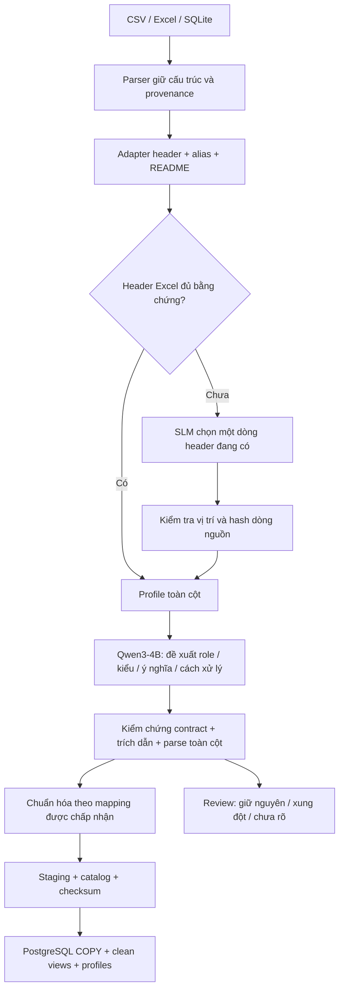

# Data pipeline v2 — semantic mapping bằng SLM local

Bản v2 bổ sung ý tưởng dùng SLM đọc README, cấu trúc và profile giá trị để đề xuất
ý nghĩa cột. Engine truy vấn vẫn là PostgreSQL. Không đọc questions/answers để dựng
schema; không thêm embedding, reranker, fine-tuning hoặc dịch vụ AI bên ngoài.



## Những gì thay đổi

- Cột lạ không bị loại bỏ. Tên nguồn, tên SQL, giá trị raw và provenance luôn giữ.
- Alias/README/declared schema tiếp tục giải quyết cột rõ nghĩa. SLM nhận các cột
  chưa biết và cột tiền có role generic để bổ sung mô tả/đề xuất; cột đã rõ được
  đưa vào context, không tự bị ghi đè khi model bất đồng.
- Model nhận README đúng business, tên cột/sheet, mô tả, mẫu giá trị đa dạng có
  giới hạn, thống kê toàn cột, các bảng liên quan và đoạn rulebook liên quan.
- Đoạn rulebook được chọn theo từ trong tên/mô tả cột, tối đa 4 đoạn nguyên văn,
  5.000 ký tự. Không dùng câu hỏi hay nhãn để chọn context. Toàn bộ rulebook vẫn
  được fingerprint và dùng kiểm tra nguồn trích dẫn.
- Profile tính trên toàn bộ record nguồn không trống; chỉ 4 giá trị mẫu/cột được
  gửi model, mỗi mẫu tối đa 160 ký tự. Thống kê parse không chỉ dựa vào sample.
- SLM chọn role từ vocabulary hiện có hoặc `other` cho khái niệm mới. Khái niệm
  mới có thể có kiểu NUMERIC/DATE/BOOLEAN mà không bị ép thành doanh thu/số lượng.
  Ý nghĩa riêng được lưu trong `semantic.proposed.meaning`.
- Nếu header Excel không đủ từ vựng/README, model có thể chọn một dòng hiện có
  trong 20 dòng đầu. Vị trí và hash dòng được kiểm tra lại lúc prepare; quyết định
  này vẫn là candidate, không phải chứng minh đã hiểu mọi layout Excel.

## Đề xuất được chấp nhận như thế nào?

Mỗi cột có đề xuất, nguồn bằng chứng, các checks và trạng thái. Không dùng confidence
model tự khai để tự động quyết định.

| Trạng thái | Ý nghĩa |
|---|---|
| `existing_mapping` | Giữ mapping từ alias/README/SQLite schema; không cần model cho cột này |
| `applied_candidate` | Áp dụng role/kiểu mới sau kiểm tra bằng chứng và toàn cột |
| `described_other` | Giữ role/kiểu hiện tại, bổ sung mô tả khái niệm |
| `annotated_existing` | Model đồng ý mapping đã có |
| `conflict_existing` | Model đề xuất khác mapping đã có; giữ mapping cũ và ghi xung đột |
| `role_conflict` | Role mới đụng operand đã có hoặc đụng đề xuất khác; giữ role cũ, chỉ giữ kiểu mới nếu parser còn tương thích |
| `unresolved` | Chưa đủ bằng chứng, dữ liệu không parse được, model chưa rõ hoặc output lỗi |

Điều kiện áp dụng:

1. Tên cột phải có trong nguồn; output không được thêm cột, SQL hoặc code xử lý.
2. Model chọn evidence ID có sẵn; code tra ID thành nguyên văn header, dòng README
   (có số dòng) hoặc đoạn rulebook. ID lạ bị từ chối, không tự bịa quote.
   Chỉ trích luật chung không đủ để gán nghĩa cho một trường cụ thể.
3. Role và kiểu vật lý phải phù hợp. ID luôn TEXT. NUMERIC không được làm mất số
   0 đầu; hệ số quy đổi phải dương.
4. Đổi sang kiểu khác TEXT cần **mọi giá trị không trống** parse được theo chính
   parser sẽ dùng lúc chuẩn hóa. Thiếu dữ liệu không chứng minh được kiểu.
5. Role mới không được che khuất operand đã có (ví dụ hai `base_quantity` khiến
   không chọn được số lượng cơ bản). Khi xung đột, giữ role cũ; kiểu vật lý đã
   kiểm chứng có thể giữ độc lập nếu parser không phụ thuộc role bị từ chối.
6. Cột đã có mapping không bị SLM đổi tự động. Trạng thái mới không tự được thêm
   vào dictionary status nếu chưa có mapping explicit.

**Qua kiểm tra cấu trúc/kiểu không chứng minh ý nghĩa nghiệp vụ đúng.** Các mapping
SLM vẫn được gắn `candidate_not_business_proof`. Grain, quan hệ và hướng xử lý theo
rulebook do model đề xuất là metadata để review, không phải lệnh thực thi. Các join
candidate của PostgreSQL được kiểm uniqueness/overlap/orphans riêng; vẫn cần xác
nhận ý nghĩa trước khi tính metric.

`safe_for_aggregation` hiện chỉ kiểm lỗi parse của cột số nguồn. Nó không thay thế
kiểm tra semantic status, dữ liệu thiếu hay derived/unit flags; không dùng riêng
flag này để cấp quyền tính metric từ một mapping model chưa được review.

## Parser và chuẩn hóa được giữ

- CSV strict UTF-8/BOM, sniff delimiter; encoding khác phải chỉ định. Dòng lệch cột
  giữ trong raw, quarantine khỏi clean view. Không tự bỏ dòng decode lỗi.
- Excel read-only, giữ vị trí ô/merged ranges/hidden rows. Formula dùng cache; cache
  thiếu/lỗi thành NULL + flag. Không gọi Excel/LibreOffice tính công thức.
- SQLite mở read-only, giữ declared types/PK/FK metadata, rồi nạp PostgreSQL.
- Tiền dùng Decimal/NUMERIC; ngày dùng mốc nguồn/sheet year, không lấy năm máy.
  Chuỗi quantity mơ hồ như `1,250` không bị đoán bừa. IDs giữ số 0 đầu.
- Fill-down chỉ trường cấp đơn trong nhóm dòng hàng liên tiếp có bằng chứng; reset
  theo đơn/store/khoảng ngắt. Không fill tiền hoặc số lượng.
- Giữ số âm, đơn hủy/trả và snapshots; metric engine sẽ chọn cách sử dụng phù hợp.
- Dedup chỉ xuất bán/đơn có mã đơn và toàn bộ raw fields trùng, có scope store.
  Giữ mọi dòng nguồn và `__duplicate_of`.
- Quy đổi theo sản phẩm/store/unit và bằng chứng README/bảng quy đổi/rulebook.
  Quantity cơ bản đã cung cấp khác phép tính đối chiếu: giữ số nguồn và ghi flag.

## Model, cache và environment

Dùng **cùng Qwen3-4B local của B1**, revision
`1cfa9a7208912126459214e8b04321603b3df60c`, CUDA bfloat16, non-thinking,
không sampling. Model load một lần cho cả run. Context budget 16.384 token,
output tối đa 2.048 token; mỗi call tối đa 5 cột cần đề xuất.

Đếm token bằng đúng tokenizer/chat template trước khi gọi model. Nếu context dài,
bỏ bản README/rulebook bị lặp và metadata vị trí lặp trong payload; giữ nguyên
ID và toàn bộ văn bản bằng chứng trong danh sách tham chiếu gọn. Nếu vẫn quá dài
thì báo lỗi, không cắt token âm thầm. JSON hỏng/hit token budget được lưu nguyên và thử lại
một lần với thông báo lỗi định dạng; cả hai lần đều có log. Nếu vẫn lỗi, giữ cột
và báo unresolved. Lỗi không load được model/GPU hoặc lỗi nguồn fatal làm run thất
bại, không tự chuyển thành kết quả đã chạy SLM.

Cache `.cache/datamate_semantics/` theo input nguồn, profile, README/rules context,
prompt, revision và cấu hình model. Thay source/model/prompt tạo cache key khác.
Log output lưu cache hit để phân biệt inference mới và replay. Fingerprint DB còn
bao gồm toàn bộ semantic plan và code chuẩn hóa. Cache là artifact local tin cậy,
không phải cơ chế chống người quản trị sửa dữ liệu.

Workspace hiện có đủ dependencies trong `.venv-b1-gpu` (đã thêm openpyxl/psycopg).
Không tạo lại env đang có. Cài bổ sung bằng:

```bash
cd /home/pc/projects/datamate
export UV_CACHE_DIR="$PWD/.cache/uv"
uv pip install --python .venv-b1-gpu/bin/python -r requirements-data-semantic.txt
uv pip check --python .venv-b1-gpu/bin/python
```

Máy mới có CUDA tương thích: tạo env Python 3.12, cài torch CUDA đã kiểm tra trước,
sau đó cài requirements. Cần mạng trong bước chuẩn bị này:

```bash
uv venv --python python3.12 .venv-b1-gpu
uv pip install --python .venv-b1-gpu/bin/python \
  torch==2.7.1 --index-url https://download.pytorch.org/whl/cu128
uv pip install --python .venv-b1-gpu/bin/python -r requirements-data-semantic.txt
```

Model/weights đã có ở `models/qwen3-4b`. Không tải lại khi inference. Setup model
ở máy mới xem [B1_MODEL_SMOKE.md](B1_MODEL_SMOKE.md). Config tham chiếu:
`configs/semantic_model.json`; snapshot environment: `configs/semantic-environment.freeze.txt`.
Không sửa global Python, driver hoặc dịch vụ PostgreSQL hệ thống.

## PostgreSQL local

Server 18.6 được giải nén vào `.cache/postgresql`; không apt install/sudo/systemd.
Chỉ nghe Unix socket private, directory/socket 0700, không TCP/cloud. Trên workspace:

```bash
python3 scripts/local_postgres.py start
export DATAMATE_PG_DSN="$(python3 scripts/local_postgres.py dsn)"
```

Máy Ubuntu 26.04 amd64 mới chưa có binaries/cluster có thể dùng
`python3 scripts/install_local_postgres.py`, rồi `python3 scripts/local_postgres.py init`.
Installer pin package và kiểm SHA-256 với apt metadata. Máy khác cấp DSN PostgreSQL
của riêng bạn. Sandbox có thể cần quyền truy cập host cho GPU/Unix socket.

## Chạy lại pipeline

Output directory phải mới. Mặc định `--semantic-mode local`; dùng env GPU.

```bash
# Một business thật:
.venv-b1-gpu/bin/python scripts/prepare_pipeline.py \
  --business-dir docs/train/data/biz_106 \
  --output-dir outputs/data_pipeline/my_semantic_run

# Toàn bộ train đã chốt:
.venv-b1-gpu/bin/python scripts/prepare_pipeline.py \
  --partition train \
  --output-dir outputs/data_pipeline/my_train_run

# Fixture tên cột mới để kiểm tra SLM; không phải dữ liệu cuộc thi:
.venv-b1-gpu/bin/python scripts/prepare_pipeline.py \
  --business-dir examples/semantic_business \
  --output-dir outputs/data_pipeline/my_demo_run

# Baseline không dùng model, có thể chạy trong env data:
.venv-data/bin/python scripts/prepare_pipeline.py \
  --partition train --semantic-mode none --prepare-only \
  --output-dir outputs/data_pipeline/my_cpu_baseline
```

`--prepare-only` chỉ bỏ bước PostgreSQL, không tự tắt SLM. Model inference luôn
local/offline/local_files_only, không gọi API AI bên ngoài.

## Tái dùng profile/semantic plan đã lưu

Có thể dùng `--semantic-plan-root <run_cũ>/_semantic` để kiểm chứng lại đề xuất
bằng validators hiện tại rồi chuẩn hóa lại nguồn, không gọi model mới. Chỉ dùng
khi policy profiling/parser không đổi; thay policy cần tăng SEMANTIC_VERSION và
profile lại. Version, business, source hashes và layout phải khớp; nguồn đổi bị
chặn. Log sao chép được đánh dấu `replayed_semantic_plan`, không tính là generation
mới. Run report ghi `cached_revalidated` và số plan reuse. Đây là đường đã dùng để
dựng lại bản release sau khi bổ sung guard chống role collision.

## Xem output mới

Run chính: `outputs/data_pipeline/semantic_train_v2/`. Kết quả kiểm chứng và số liệu
thực tế được ghi trong [DATA_PIPELINE_VALIDATION.json](DATA_PIPELINE_VALIDATION.json).

```text
semantic_train_v2/
├── run.json
├── database_validation.json
├── semantic_overview.md             # tổng quan để bắt đầu review
├── semantic_overview.json
├── inference_origin.json           # cấu hình/thống kê inference gốc
├── previous_release_summary.json    # số liệu aggregate cũ để so sánh
├── _semantic/biz_xxx/
│   ├── model_calls.jsonl             # prompt, raw output, parse errors, timings, cache
│   └── semantic_plan.json
└── biz_xxx/
    ├── semantic_review.md            # xem từng cột dễ đọc
    ├── semantic_review.json          # proposal, evidence reference/quote, checks, type/role và profile
    ├── semantic_plan.json
    ├── catalog.json
    ├── postgres_catalog.json
    ├── normalization_errors.jsonl
    └── tables/*.jsonl
```

Bắt đầu bằng `semantic_overview.md`, sau đó mở `biz_106/semantic_review.md` hoặc
business bạn quan tâm. Những cột conflict/unresolved cần đọc đề xuất và lý do trước.

```bash
# Chỉ xem semantic review: không cần PostgreSQL/GPU
.venv-data/bin/python scripts/inspect_pipeline.py \
  --prepared-dir outputs/data_pipeline/semantic_train_v2/biz_106 \
  --semantic | python3 -m json.tool

# Liệt kê bảng từ catalog
.venv-data/bin/python scripts/inspect_pipeline.py \
  --prepared-dir outputs/data_pipeline/semantic_train_v2/biz_101 \
  | python3 -m json.tool

# Xem 5 dòng; preview không phải kết quả đủ để SUM/COUNT
.venv-data/bin/python scripts/inspect_pipeline.py \
  --prepared-dir outputs/data_pipeline/semantic_train_v2/biz_101 \
  --table ban_hang_d8848a70_clean --preview --limit 5 \
  | python3 -m json.tool
```

Trong PostgreSQL, mỗi business/version có schema riêng theo fingerprint. Raw tables
có cột typed, `__raw`, `__source`, `__quality`, `__row_kind`, `__duplicate_of`,
`__quantity_base`, `__unit_base`. Clean views loại header/subtotal/quarantine và
bản trùng; lỗi parse ở một cột vẫn có thể là NULL. Không coi SUM bỏ qua NULL là
kết quả đầy đủ. Mapping SLM mới cũng không tự chữa mâu thuẫn dữ liệu nguồn.

## Kết quả thực tế bản đã chạy

Đã dựng lại đủ **18 business train**, **2.040.280 dòng nguồn**, **80 bảng**.
Clean views có 2.033.999 dòng, 6.281 dòng trùng vẫn giữ raw. 90/90 tests qua,
không skip; split và nguồn đóng băng giữ nguyên checksum.

| Semantic status | Số cột |
|---|---:|
| Mapping có sẵn giữ nguyên | 416 |
| Bổ sung mô tả, giữ role/kiểu | 178 |
| Mapping mới áp dụng sau gate | 10 |
| Model đồng ý mapping cũ | 24 |
| Model bất đồng mapping cũ, giữ cũ | 11 |
| Role đề xuất đụng operand khác, chặn role | 11 |
| Chưa rõ hoặc proposal không đạt | 21 |

Có **4 bảng** có ít nhất một batch output model không đạt contract sau các bước
kiểm tra; các cột liên quan được giữ và gắn lỗi, không loại khỏi database. 4 lỗi
parse được ghi trong lịch sử attempts, gồm các lần đã retry; đây không phải số
bảng lỗi cuối cùng hay điểm semantic accuracy.

SLM thật đã chạy 65 generation calls và dùng 11 cache hits trong lượt inference
nguồn. Sau khi phát hiện role collision, bản cuối tái kiểm chứng 18 plan, chuẩn
hóa lại toàn bộ nguồn và nạp DB trong khoảng **6 phút 34 giây**, không gọi model
lặp. Các log replay được đánh dấu; GPU peak/token counts trong log là quan sát
của inference gốc, không phải tài nguyên của lượt dựng lại bằng cache.

Ví dụ đúng đã đối chiếu README: biz_114 có `Mã GD` → order_id, `Sluong` → quantity,
`Sản phẩm` → product_name, `Tên khách` → customer_name. Kiểm mẫu này không chứng
minh tất cả mapping model đều đúng. Ví dụ guard cần thiết: biz_113, model gán
`SL bán` thành base_quantity dù đã có cột quantity cơ bản; bản cuối giữ kiểu
NUMERIC nhưng không áp role trùng, nên không che khuất 32.994 giá trị cơ bản nguồn.

Đối soát PG qua trên cả 80 bảng: raw/clean counts, **169 SUM cột số nguồn**, cùng
**80 SUM và non-null counts của quantity cơ bản dẫn xuất** khớp staging.
Vẫn có **4.998 sai khác quantity cơ bản cung cấp/phép tính đối chiếu** và **969 dòng
chưa xác định quantity cơ bản**. Giữ số nguồn và flags; không ép dữ liệu để khớp.
0 lỗi chuẩn hóa ô không đồng nghĩa mọi metric hay metadata đã được xác minh.

Fixture `examples/semantic_business` cũng đã chạy SLM thật và PG: 2 dòng, 5 proposal
được áp dụng và 1 khái niệm giữ nguyên; còn 2 quantity cơ bản chưa rõ vì fixture
không có cột đơn vị. Output ở `outputs/data_pipeline/semantic_demo_v2`.

## Kiểm chứng và giới hạn

```bash
export DATAMATE_TEST_PG_DSN="$DATAMATE_PG_DSN"
.venv-b1-gpu/bin/python -m unittest discover -s tests -v

.venv-data/bin/python scripts/validate_pipeline.py \
  --run-dir outputs/data_pipeline/semantic_train_v2 \
  --output outputs/data_pipeline/semantic_train_v2/database_validation.json

python3 scripts/prepare_data_split.py --verify
```

Có thể tạo lại trang tổng quan sau run hoàn thành:

```bash
.venv-data/bin/python scripts/summarize_semantic.py \
  --run-dir outputs/data_pipeline/semantic_train_v2
```

Unit tests semantic dùng model stub/synthetic để kiểm gate, không giả làm inference
model thật. Log `_semantic/*/model_calls.jsonl` là inference/replay Qwen3-4B thật.
SQLite actual business thuộc calibration nên chưa chạy; parser SQLite có synthetic
integration. Không xử lý development/calibration/holdout/public ở run train này.

Chưa nối model hỏi đáp/SQL runner, chưa làm metric engine hoàn chỉnh, training,
embedding/reranker, production Docker hay sandbox thực thi SQL model. Model chỉ
đề xuất metadata; API preview chỉ nhận bảng từ catalog, query cố định, readonly và
limit 1–100. Owner DSN ingestion không được đưa cho arbitrary SQL do model sinh.

Dừng server khi không dùng: `python3 scripts/local_postgres.py stop`.

Nguồn kỹ thuật: [PostgreSQL initdb](https://www.postgresql.org/docs/18/app-initdb.html),
[psycopg COPY](https://www.psycopg.org/psycopg3/docs/basic/copy.html),
[openpyxl read-only](https://openpyxl.readthedocs.io/en/stable/optimized.html).
